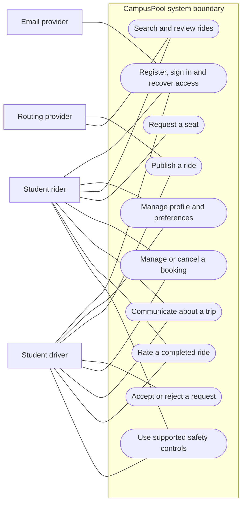
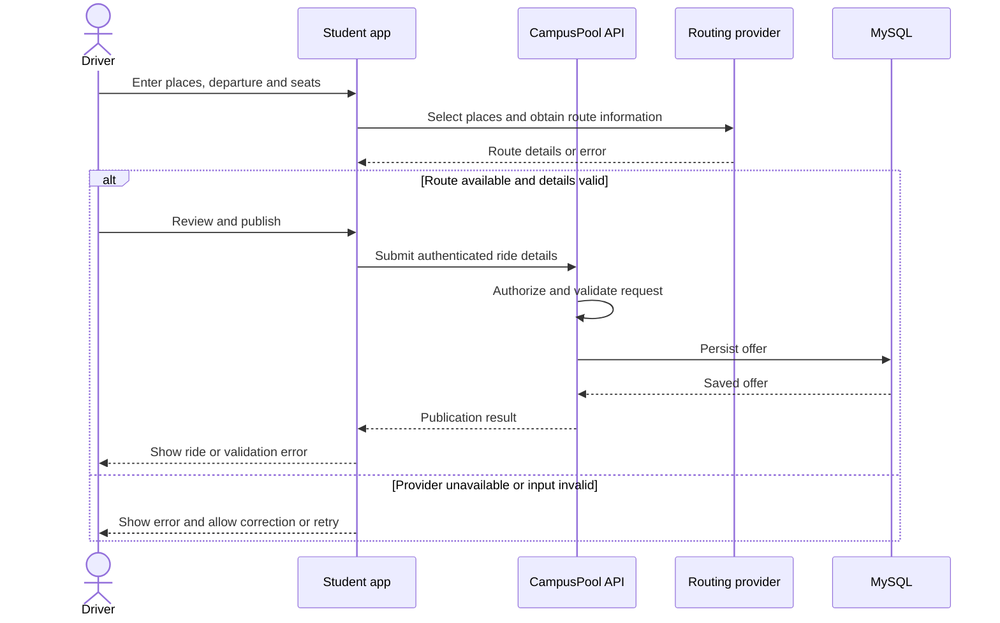
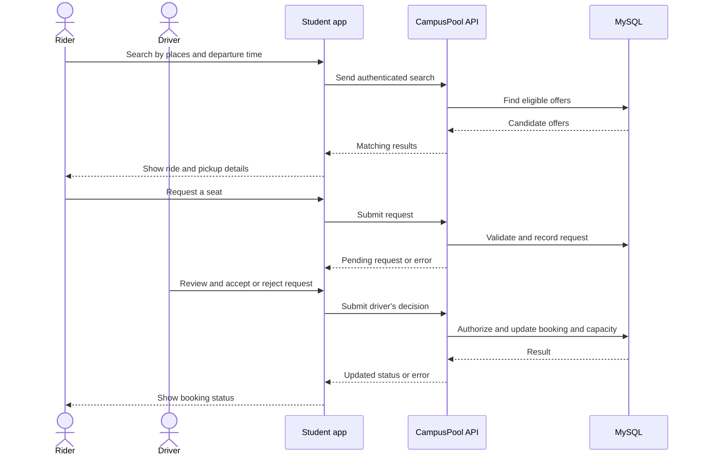
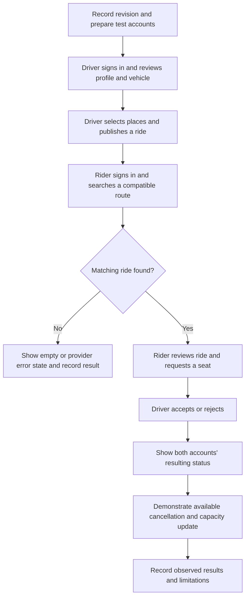

# SE demonstration: use cases and flows

Working diagrams for the student preview. The [SE guidance review](COURSE_REVIEW_2026-11-14.md) calls for at least one use-case diagram and two sequence diagrams. These show intended interactions at a conceptual level; they are not evidence that an end-to-end flow has passed. Reconcile them with the revision and environment actually demonstrated. See the [functional](FUNCTIONAL_REQUIREMENTS.md) and [non-functional](NON_FUNCTIONAL_REQUIREMENTS.md) requirements.

## Use-case diagram

The same student may act as a rider or driver in different rides. External providers support the application; they are not university administrators.

## Sequence 1: driver publishes a ride

## Sequence 2: rider requests and driver responds

## Demonstration flow

Use only authorized test accounts and avoid exposing credentials or private locations. The two-person Ola journey remains an evidence item in the scope review; do not present this diagram as proof that it passed. Show demo wallet and vehicles as simulated. If an action fails or is unavailable, record the result instead of implying completion. The existing [runbook](DEMO_RUNBOOK.md) describes a separate disposable synthetic environment and should be labeled accordingly.
