# MobilityPlatform actual-schema ERD

This is a conceptual **selected-domain slice** derived from the Laravel migrations in
`backend/extensions/carpoolear/migrations/`. It is not a dump of a live
database and contains no user rows. Solid arrows are declared database
foreign keys. Dashed arrows are intentional logical associations where the
migrations store an identifier or JSON snapshot but do not declare an FK.

```mermaid
erDiagram
    users }o..|| trips : "host platform association"
    users }o..|| trip_passengers : "host platform association"
    trips ||--o| mobility_trip_lifecycles : "FK trip_id"
    trips ||--o{ mobility_trip_participants : "FK trip_id"
    trip_passengers ||--o{ mobility_trip_participants : "FK booking_id"
    users ||--o{ mobility_trip_participants : "FK user_id"
    trips ||--o{ mobility_trip_events : "FK trip_id"
    users ||--o{ mobility_trip_events : "FK actor_id / passenger_id"

    trips ||--o{ mobility_fare_snapshots : "FK trip_id"
    trip_passengers ||--o| mobility_fare_snapshots : "FK booking_id"
    trips ||--o{ mobility_payment_attempts : "FK trip_id"
    trip_passengers ||--o{ mobility_payment_attempts : "FK booking_id"
    mobility_payment_attempts ||--o{ mobility_payout_allocations : "FK payment_attempt_id"
    mobility_payout_allocations ||--o| mobility_payout_outbox : "FK allocation_id"
    users ||--o{ mobility_payment_beneficiaries : "FK user_id"
    users ||--o{ mobility_payout_allocations : "FK driver_id"

    nodes_geo ||--o{ mobility_pickup_points : "FK canonical_node_id"
    users ||--o{ mobility_route_quotes : "FK user_id"
    trips ||--o{ mobility_route_quotes : "nullable FK consumed_trip_id"
    mobility_route_quotes ||--o{ mobility_route_quotes : "nullable FK parent_quote_id"
    cars ||--o{ mobility_recurring_programs : "FK car_id"
    mobility_route_quotes ||--o| mobility_recurring_programs : "FK source_quote_id"
    mobility_recurring_programs ||--o{ mobility_recurring_occurrences : "FK program_id"
    trips ||--o| mobility_recurring_occurrences : "FK trip_id"
    mobility_route_quotes ||--o| mobility_recurring_occurrences : "FK quote_id"
    mobility_recurring_programs ||--o{ mobility_recurring_exceptions : "FK program_id"
    mobility_recurring_programs ||--o{ mobility_recurring_actions : "FK program_id"
    users ||--o{ mobility_recurring_exceptions : "FK actor_id"
    users ||--o{ mobility_recurring_actions : "FK actor_id"

    mobility_route_quotes ||--o{ mobility_match_references : "FK quote_id"
    trips ||--o{ mobility_match_references : "FK trip_id"
    users ||--o{ mobility_match_references : "FK user_id"
    trip_passengers ||--o{ mobility_match_references : "nullable FK booking_id"
    trip_passengers ||--o| mobility_booking_intervals : "FK booking_id"
    mobility_route_quotes ||--o{ mobility_booking_intervals : "FK quote_id"
    mobility_match_references ||--o{ mobility_booking_intervals : "nullable FK match_reference_id"

    mobility_route_quotes ||--o| mobility_dispatch_requests : "FK quote_id"
    users ||--o{ mobility_dispatch_requests : "FK rider_id"
    mobility_pickup_points ||--o{ mobility_dispatch_requests : "FK pickup_point_id"
    mobility_dispatch_requests ||--o{ mobility_dispatch_offers : "FK request_id"
    users ||--o{ mobility_dispatch_offers : "FK driver_id"
    cars ||--o{ mobility_dispatch_offers : "FK car_id"
    mobility_dispatch_offers ||--o| mobility_dispatch_assignments : "FK offer_id"
    mobility_dispatch_requests ||--o{ mobility_dispatch_assignments : "FK request_id"
    mobility_dispatch_assignments ||--o| trips : "FK trip_id"
    mobility_dispatch_assignments ||--o| trip_passengers : "FK booking_id"
    mobility_dispatch_requests ||--o{ mobility_dispatch_events : "nullable FK request_id"

    mobility_commute_demo_actors }o..|| users : "logical user_id; no FK"
    mobility_commute_demo_trips }o..|| trips : "logical trip_id; no FK"
    mobility_commute_matches }o..|| mobility_commute_demo_trips : "logical trip_id; no FK"
    mobility_commute_matches }o..|| users : "logical rider_id; no FK"
    mobility_commute_booking_terms }o..|| mobility_commute_matches : "logical match_key; no FK"
    mobility_commute_demo_holds }o..|| trip_passengers : "logical booking_id; no FK"
    mobility_commute_demo_entries }o..|| trip_passengers : "logical booking_id; no FK"
```

## Reading the model

The host tables `users`, `trips`, `trip_passengers`, `cars`, and `nodes_geo`
are not defined by this extension. The arrows above only claim a relationship
where an extension migration explicitly calls `foreign(...)`; host-platform
associations shown with dashed arrows are deliberately not claimed as FKs by
this document. The host tables' other columns and relationships are outside
this document's scope.

This slice omits several extension tables outside the requested
commute/matching/lifecycle/recurring/dispatch/financial path (for example,
cohort, onboarding, communications, pickup-agreement, and reporting tables).
Their omission is not evidence that they do not exist.

The commute-demo tables are deliberately a separate, compact product surface.
Their integer identifiers are application-level references and the migrations
do not declare cross-table foreign keys. The same is true of `booking_id` in
the demo wallet/hold/entry tables. They must therefore be reconciled by
service code and tests, not described as enforced referential integrity.

The JSON columns (`snapshot`, `journey`, `config_snapshot`, response/payload
columns, and snapshots in scheduled/recurring workflows) are immutable
decision evidence, not substitutes for every relational edge. They preserve
the terms used at quote, booking, dispatch, and financial boundaries.
