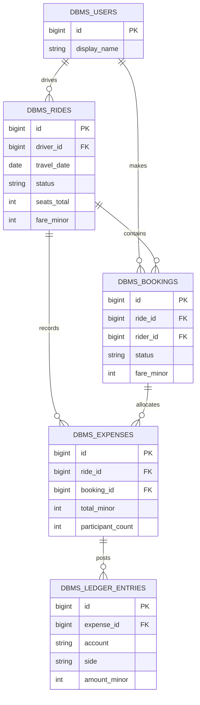
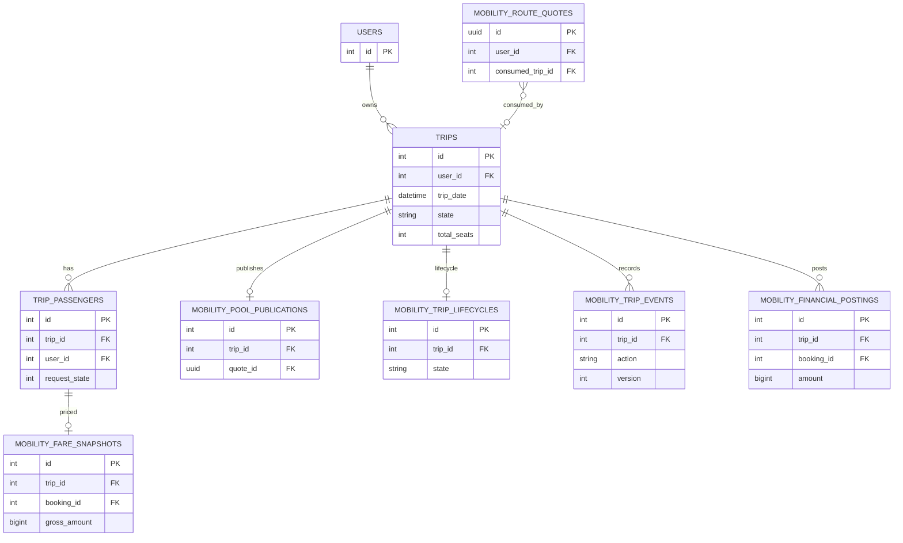

# Relational model

The model is intentionally compact for repeatable SQL evidence. Its keys and relationships mirror the production concepts in the Laravel migrations, while the `dbms_` prefix prevents accidental collision with application tables. This first diagram is an isolated executable fixture; its FKs and cardinalities are enforced only inside that disposable schema.

## Actual MobilityPlatform relationship slice

This is a documented relationship slice, not a new migration. Exact base-table definitions come from the host platform; extension FKs and columns are defined in `backend/extensions/carpoolear/migrations/`. Relationships shown for `USERS`, `TRIPS`, and `TRIP_PASSENGERS` are conceptual host-schema links; extension relationships backed by migration FKs are enforced. `consumed_trip_id` is nullable and non-unique, so one route quote can be referenced by zero or more trips at the schema level.
