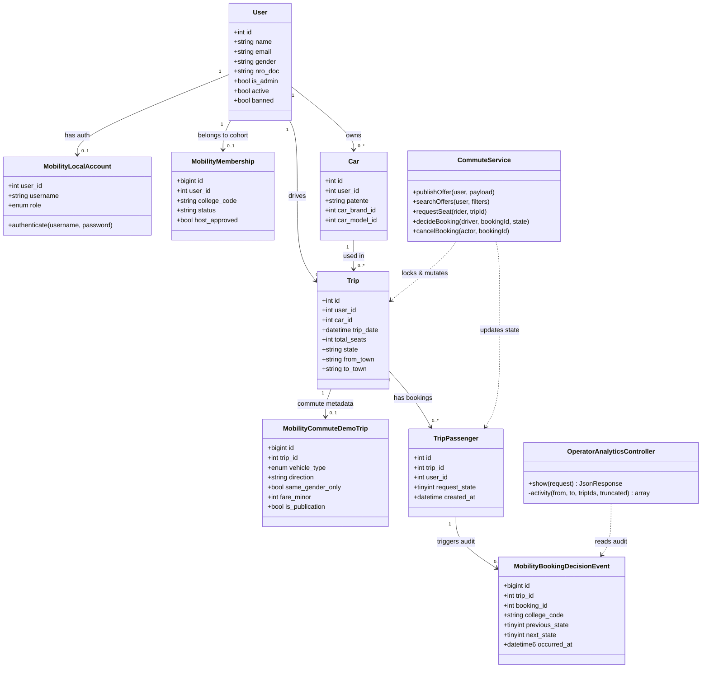
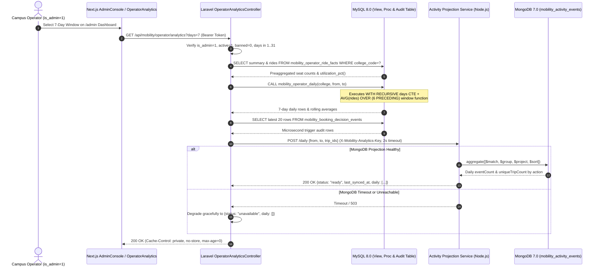

# Software Architecture and Design Specification (SAD)

- **Project:** CampusPool — Collegiate Carpooling & Multi-Model Mobility Platform
- **Version:** 2.0 (Final Sprint-Reconciled Architecture)
- **Authors:**
  - Arjun Srikanth (`PES1UG24AM920` — `@arjunsrikanthh`)
  - Zayaan Ahmed (`PES1UG24AM457` — `@zayaan-06`)
  - Nikhil Suhas Joshi (`PES1UG24AM441` — `@NikhilJoshi441`)
  - NITHESH (`PES1UG24AM443` — `@NitheshMogaveer777`)
- **Date:** 16-11-2026
- **Status:** Final / Frozen for Evaluation
- **Repository:** [https://github.com/CampusPool/carpooling](https://github.com/CampusPool/carpooling)

---

## Revision History

| Version | Date | Author | Change Summary |
| :--- | :--- | :--- | :--- |
| 1.0 | 12-10-2026 | CampusPool Team | Initial IEEE 42010 SAD baseline: layered architecture, component boundaries, and sequence flows |
| 1.5 | 29-10-2026 | NITHESH & Nikhil Suhas Joshi | Added CQRS read-model separation (MySQL 8.0 + MongoDB 7.0), trigger audit lineage, and recursive CTE procedure design |
| 2.0 | 16-11-2026 | Arjun Srikanth & Zayaan Ahmed | Reconciled Sprint-2/3 additions: Ola Maps routing adapter, PES email OTP/password boundary, symmetric same-gender matching, PES Academy timetable proxy, and `/admin` DBMS Control Center |

---

## Approvals

| Role | Name | SRN / GitHub Handle | Signature / Date |
| :--- | :--- | :--- | :--- |
| Architecture & Backend Lead | Arjun Srikanth | `PES1UG24AM920` (`@arjunsrikanthh`) | Approved — 16-11-2026 |
| Frontend & UX Architecture Lead | Zayaan Ahmed | `PES1UG24AM457` (`@zayaan-06`) | Approved — 16-11-2026 |
| Routing & Performance Lead | Nikhil Suhas Joshi | `PES1UG24AM441` (`@NikhilJoshi441`) | Approved — 16-11-2026 |
| Data Model & NoSQL Lead | NITHESH | `PES1UG24AM443` (`@NitheshMogaveer777`) | Approved — 16-11-2026 |
| Course Evaluator | Department of CSE | PES University | _Pending Final Demo_ |

---

## 1. Introduction

### 1.1 Purpose
This Software Architecture and Design Specification (SAD) defines the structural decomposition, architectural patterns, component interfaces, data models (relational 3NF and NoSQL document schemas), concurrency mechanisms, security architecture (STRIDE threat model), UML class/component diagrams, UML sequence diagrams, and REST API contracts for **CampusPool v2.0** in accordance with IEEE 42010 / IEEE 1016 standards.

### 1.2 Scope
This specification covers all four tiers of the CampusPool platform:
1. **Presentation Tier (`frontend-next/`):** Next.js 14 / React 19 single-page workspace, server-side Ola Maps & PES Academy proxies, and the `/admin` DBMS Control Center.
2. **Application & API Gateway Tier (`backend/extensions/carpoolear/`):** Nginx reverse proxy and Laravel 11 (PHP 8.2) domain services for identity, vehicle onboarding, commute matching, row-locked seat booking, trip chat, safety checks, and operator reporting.
3. **Authoritative Transactional Data Tier (`MySQL 8.0 / InnoDB`):** 3NF relational tables, foreign keys, `CHECK` constraints, `SELECT ... FOR UPDATE` locks, `AFTER INSERT/UPDATE` decision triggers, preaggregated views, deterministic functions, and recursive-CTE stored procedures.
4. **Asynchronous Read-Model & Geospatial Tier (`MongoDB 7.0`, `Node.js`, `Ola Maps` & `OSRM`):** Idempotent event replay service (`services/activity-projection/`), `$jsonSchema`-validated MongoDB collection, 4-stage `$group`/`$sum` aggregation pipeline, and multi-modal route providers.

### 1.3 Audience
Software Engineering and DBMS evaluators, system architects, backend/frontend developers, and QA engineers.

### 1.4 Definitions
- **ADR:** Architecture Decision Record.
- **CQRS:** Command Query Responsibility Segregation.
- **STRIDE:** Spoofing, Tampering, Repudiation, Information Disclosure, Denial of Service, Elevation of Privilege.
- **Idempotency-Key:** Client-generated UUID header preventing duplicate mutation execution on retry.

---

## 2. Document Overview

### 2.1 How to Use This Document
- **Section 3 (Architecture)** presents the high-level system structure, UML Component and Class diagrams, Architecture Decision Records (ADRs), database schemas, risk analysis, requirement traceability, and STRIDE security architecture.
- **Section 4 (Design)** provides concrete implementation blueprints, including **three UML Sequence Diagrams**, **six REST API interface specifications**, error-handling protocols, UX design rules, and **documented Sprint deviations**.

### 2.2 Related Documents
- [Software Requirements Specification (`SRS.md`)](./SRS.md)
- [Software Test Plan & Updated Test Cases (`STP_and_Test_Cases.md`)](./STP_and_Test_Cases.md)
- [Agile Backlog & Sprint Execution Plan (`Agile_Backlog_and_Sprint_Plan.md`)](./Agile_Backlog_and_Sprint_Plan.md)
- [Unit Test Report (`Unit_Test_Report.md`)](./Unit_Test_Report.md), [System Validation Report (`System_Validation_Report.md`)](./System_Validation_Report.md), [Code Coverage Report (`Code_Coverage_Report.md`)](./Code_Coverage_Report.md), and [Branch Coverage Report (`Branch_Coverage_Report.md`)](./Branch_Coverage_Report.md)

---

## 3. Architecture

### 3.1 Goals & Constraints
- **Architectural Goals:**
  1. **Zero Overbooking Under Contention:** Guarantee that concurrent seat acceptances never exceed offered vehicle seats (`CP-NF-002`).
  2. **Strict Fault Isolation:** Ensure that MongoDB analytical projection downtime or routing provider errors never corrupt or block MySQL transactional bookings (`CP-NF-003`).
  3. **Sub-Second Interactive Latency:** Keep login and ride search latencies well below the `2,000 ms` target (`p90 = 22 ms` and `46 ms`, `CP-NF-001`).
  4. **Defense-in-Depth Security:** Enforce authentication, role/cohort authorization, rate limiting, and server-side API key isolation at every boundary (`CP-SR-001`..`CP-SR-006`).
- **Constraints:**
  - Must integrate cleanly with the reconstructed GPLv3 Carpoolear host tables (`users`, `cars`, `trips`, `trip_passengers`) via modular Laravel extension migrations (`backend/extensions/carpoolear/migrations/`).
  - Must satisfy both Software Engineering (IEEE SRS/SAD/STP, Agile Sprints, Coverage) and DBMS Level-3 (MySQL 8.0 + MongoDB 7.0, Views, Triggers, Procedures, CTEs, Window Functions) evaluation rubrics.

### 3.2 Stakeholders & Concerns

| Stakeholder | Primary Concerns | Architectural Response |
| :--- | :--- | :--- |
| **Student Riders & Drivers** | Fast route discovery, safety (same-gender matching & trusted-contact alerts), no double-bookings | Indexed SQL discovery, symmetric gender filter in `CommuteService`, `FOR UPDATE` row locks, and `RideSafety` alerts |
| **Campus Operators / Admins** | Accurate daily capacity utilization, auditability of booking decisions, schema health | `mobility_operator_ride_facts` view, `mobility_operator_daily` procedure, `AFTER` triggers, and `/admin` console |
| **Course Evaluators (SE & DBMS)** | Standards compliance, clear SQL vs. NoSQL justification, reproducible tests, honest scope boundaries | Explicit CQRS read-model separation, one-command verifiers (`verify-dbms-level3.sh`), and transparent demo labels |
| **Development Team** | Modularity, merge safety across 4 contributors, deterministic CI | Isolated domain namespaces (`STS\Mobility\*`), Vitest + PHPUnit suites, and GitHub Actions workflows |

---

### 3.3 Component & UML Class Diagrams

#### 3.3.1 Multi-Tier Component Architecture Diagram

```mermaid
flowchart TB
    subgraph Tier1["Tier 1: Presentation & Edge Proxy Layer (Next.js 14 / React 19)"]
        UI_Auth["StudentSignIn / LocalAccountLanding<br/>(OTP, Password & Role/Gender UI)"]
        UI_Commute["LiveCarpool / AddressRides / CanonicalPool<br/>(Same-Gender Toggle & Route Search)"]
        UI_Driver["DriverOnboarding<br/>(4-Field Setup & 10-Car Catalogue)"]
        UI_Extras["PesTimetable / RideConversation /<br/>RideSafety / RideRating"]
        UI_Admin["AdminConsole / OperatorAnalytics<br/>(/admin Control Center)"]
        NextProxy["Next.js Server Route Proxies<br/>(/api/ola/* & /api/pes-timetable)"]
    end

    subgraph Tier2["Tier 2: Application & Domain Service Layer (Nginx + Laravel 11)"]
        AuthSvc["Identity & Auth Services<br/>(LocalAccountAuth, CollegeEmailAuth,<br/>StudentPasswordAuth, AdminLoginThrottle)"]
        CommuteSvc["Commute & Matching Services<br/>(CommuteService, CommuteMatchingService,<br/>AddressRideController, PickupSelectionService)"]
        BookingSvc["Booking & Lifecycle Services<br/>(SegmentBookingService, TripLifecycleService,<br/>DriverReservationPolicy)"]
        SafetySvc["Communication & Safety Services<br/>(TripCommunicationController,<br/>StudentSafetyController, SafetyNotifier)"]
        OperCtrl["Operator & DBMS Controllers<br/>(OperatorAnalyticsController,<br/>OperatorDatabaseHealthController)"]
    end

    subgraph Tier3["Tier 3: Authoritative ACID Data Tier (MySQL 8.0 / InnoDB)"]
        SQL_Core[("Core & Extension Tables<br/>users, cars, trips, trip_passengers,<br/>mobility_local_accounts, mobility_memberships,<br/>mobility_commute_demo_trips, mobility_trip_lifecycles")]
        SQL_Trig["In-Transaction Triggers<br/>mobility_booking_decision_insert / update<br/>-> mobility_booking_decision_events"]
        SQL_Routine["Analytical SQL Objects<br/>VIEW: mobility_operator_ride_facts<br/>FUNC: mobility_utilization_pct()<br/>PROC: mobility_operator_daily()"]
    end

    subgraph Tier4["Tier 4: Asynchronous Read-Model & External Providers"]
        ProjSvc["Node.js Activity Projection Service<br/>(services/activity-projection)"]
        Mongo[("MongoDB 7.0 Read Model<br/>mobility_activity_events<br/>($jsonSchema + sourceEventId_1)")]
        Routing["Geospatial Providers<br/>(Ola Maps REST API / OSRM Cluster)"]
        Academy["PES Academy Portal<br/>(Transient Timetable Source)"]
    end

    UI_Auth & UI_Commute & UI_Driver & UI_Extras & UI_Admin -->|"JWT + Idempotency-Key"| AuthSvc & CommuteSvc & BookingSvc & SafetySvc & OperCtrl
    UI_Commute & UI_Extras --> NextProxy
    NextProxy -->|"Server-Key / Bounded HTTPS"| Routing & Academy
    CommuteSvc -->|"Route Quotes"| Routing
    AuthSvc & CommuteSvc & BookingSvc & SafetySvc -->|"PDO Transactions & FOR UPDATE"| SQL_Core
    SQL_Core -->|"AFTER INSERT / UPDATE"| SQL_Trig
    OperCtrl -->|"SELECT & CALL"| SQL_Routine & SQL_Trig
    ProjSvc -->|"Read-Only Snapshot"| SQL_Core
    ProjSvc -->|"Idempotent Upsert & $group"| Mongo
    OperCtrl -->|"POST /daily (2s Timeout)"| ProjSvc
```



#### 3.3.2 UML Domain Class Diagram



---

### 3.4 Component Descriptions

- **`Frontend Client & Server Proxies (frontend-next/)`:**
  - `app/page.tsx` & `components/StudentDashboard.tsx`: Central state coordinators managing session tokens, active role/mode switching, and child views.
  - `components/LiveCarpool.tsx` & `components/AddressRides.tsx`: Provide route discovery, Ola/Google place pickers, walking distance indicators, and the symmetric `same_gender_only` filter toggle.
  - `components/DriverOnboarding.tsx`: Implements our 4-field driver onboarding and 10-vehicle demo catalogue selector.
  - `components/AdminConsole.tsx` & `components/OperatorAnalytics.tsx`: Render SQL summary metrics, 7-day rolling averages, trigger audit logs, DBMS table health, and MongoDB sync status.
  - `app/api/ola/*` & `app/api/pes-timetable/route.js`: Server-side route handlers that keep `OLA_MAPS_API_KEY` private and bound PES Academy requests to `4,096` bytes / `2 MB` stream limits.
- **`Identity & Trust Module (STS\Mobility\Identity & STS\Mobility\Trust)`:**
  - `LocalAccountAuth.php`, `CollegeEmailAuth.php`, `StudentPasswordAuth.php`: Manage account creation, email OTP issuance/invalidation, `bcrypt` password verification, and normalized gender storage.
  - `DriverOnboardingController.php` & `DemoVehicle.php`: Validate vehicle plates, categories (`car`/`bike`), seat limits, and driving licenses (`nro_doc`).
- **`Commute, Routing & Booking Module (STS\Mobility\Commute, Routing & Segments)`:**
  - `OlaDirectionsClient.php` & `OsrmRouteProvider.php`: Compute driving polylines and foot walking approaches, enforcing `< 1,000 m` combined walking distance.
  - `CommuteService.php`, `CommuteMatchingService.php`, & `SegmentBookingService.php`: Enforce symmetric same-gender matching, execute `SELECT ... FOR UPDATE` row-locked seat acceptances, prevent driver self-booking, and restore capacity on cancellation.
- **`Operator Analytics & Projection Module (STS\Mobility\OperatorAnalyticsController & services/activity-projection/)`:**
  - `OperatorAnalyticsController.php`: Queries `mobility_operator_ride_facts`, invokes `CALL mobility_operator_daily(?, ?, ?)`, fetches `mobility_booking_decision_events`, and calls the Node/MongoDB projection service with a `2s` timeout.
  - `services/activity-projection/src/service.mjs`: Replays allow-listed `mobility_trip_events` from MySQL into MongoDB (`mobility_activity_events`) using idempotent `{ sourceEventId: 1 }` upserts and serves the 4-stage `/daily` aggregation pipeline.

---

### 3.5 Chosen Architecture Pattern and Rationale

We adopted a **Layered Service-Oriented Architecture combined with Command Query Responsibility Segregation (CQRS)**:
1. **ADR-001 (CQRS Multi-Model Database Split — MySQL 8.0 + MongoDB 7.0):**
   - *Decision:* Use MySQL 8.0 (InnoDB) for all transactional commands and relational state, and MongoDB 7.0 exclusively for asynchronous event-projection queries.
   - *Rationale:* Seat reservations and financial postings require strict multi-row ACID transactions, foreign keys, and pessimistic row-level locks (`SELECT ... FOR UPDATE`). Conversely, operator activity timelines involve high-volume append-only event streams (`publish`, `request`, `accept`, `cancel`, `complete`) grouped across timezones and date windows—a workload naturally suited to MongoDB's `$match` → `$group` → `$project` → `$sort` aggregation pipeline without contending with booking locks.
2. **ADR-002 (Preaggregated SQL View & Stored Procedure with Recursive CTE):**
   - *Decision:* Encapsulate ride capacity math in `mobility_operator_ride_facts` (view) and 7-day rolling averages in `mobility_operator_daily` (stored procedure).
   - *Rationale:* Joining `trips` directly to `trip_passengers` and other child tables causes N×M relational fan-out. Preaggregating seat counts per `trip_id` in a subquery prevents fan-out, while `WITH RECURSIVE` in the procedure synthesizes zero-ride calendar dates so the 7-day window average (`AVG(rides) OVER (...)`) is mathematically exact.
3. **ADR-003 (Server-Side Geospatial & Timetable Proxy Pattern):**
   - *Decision:* Route all Ola Maps and PES Academy network requests through Next.js/Laravel server proxies rather than direct browser calls.
   - *Rationale:* Protects provider API keys from client extraction, enforces strict byte/timeout bounds, and prevents cross-origin credential leakage.

---

### 3.6 Technology Stack & Data Stores

| Layer | Technology | Role in CampusPool |
| :--- | :--- | :--- |
| **Frontend UI** | Next.js 14, React 19, TypeScript, CSS Modules | Responsive student & operator web interface and server proxies |
| **Backend API** | Laravel 11, PHP 8.2, Nginx | REST controllers, RBAC/OTP guards, transactional services |
| **Primary SQL DB** | MySQL 8.0 (InnoDB) | 3NF tables, FK/CHECK/UNIQUE constraints, locks, triggers, views, procedures |
| **NoSQL Read Model** | MongoDB 7.0 + Node.js 20 | `$jsonSchema`-validated `mobility_activity_events` collection & aggregation pipeline |
| **Geospatial Engine** | Ola Maps REST API + OSRM (`car`/`bike`/`foot`) | Route polylines, ETA quotes, static route maps, `<1km` walking validation |
| **Testing & CI** | Vitest, PHPUnit 10, Node Test Runner, GitHub Actions | Automated unit, integration, concurrency, and DBMS verification suites |

#### Relational & NoSQL Schema Summary

| Table / Collection | Primary Key (PK) | Foreign Keys (FK) & Cardinality | Engine Constraints & Indexes |
| :--- | :--- | :--- | :--- |
| `users` | `id` (`INT UNSIGNED`) | `1:1` local_accounts/memberships; `1:N` cars/trips | `UNIQUE(email)`, gender normalization, `nro_doc`, `is_admin`, `active` |
| `mobility_local_accounts` | `user_id` (`INT UNSIGNED`) | `FK(user_id) -> users(id)` (`1:1`, `CASCADE`) | `UNIQUE(username)`, `role IN ('rider','driver')` |
| `mobility_memberships` | `id` (`BIGINT UNSIGNED`) | `FK(user_id) -> users(id)` (`1:1`, `CASCADE`) | `UNIQUE(user_id)`, `INDEX(college_code)`, `host_approved` |
| `cars` | `id` (`INT UNSIGNED`) | `FK(user_id) -> users(id)` (`N:1`, `CASCADE`) | `patente` (`VARCHAR(10)`), `car_brand_id`, `car_model_id` |
| `trips` | `id` (`INT UNSIGNED`) | `FK(user_id) -> users(id)`, `FK(car_id) -> cars(id)` | `CHECK(total_seats > 0)`, `INDEX(trip_date)`, row-lock target |
| `mobility_commute_demo_trips` | `id` (`BIGINT UNSIGNED`) | `UQ/FK(trip_id) -> trips(id)` (`1:1`) | `vehicle_type IN ('car','bike')`, `same_gender_only`, `fare_minor` |
| `mobility_trip_lifecycles` | `id` (`BIGINT UNSIGNED`) | `UQ/FK(trip_id) -> trips(id)` (`1:1`, `CASCADE`) | `state IN ('planned','active','completed','cancelled')`, `version` |
| `trip_passengers` | `id` (`INT UNSIGNED`) | `FK(trip_id) -> trips(id)`, `FK(user_id) -> users(id)` | `request_state IN (0,1,2,3)`; fires `AFTER INSERT/UPDATE` triggers |
| `mobility_booking_decision_events` | `id` (`BIGINT UNSIGNED`) | `FK(trip_id)` `CASCADE`, `FK(booking_id)` `SET NULL` | `occurred_at DATETIME(6)`, `INDEX(college_code, trip_id, id)` |
| `mobility_financial_postings` | `id` (`BIGINT UNSIGNED`) | `FK(trip_id) -> trips(id)`, `FK(booking_id)` | Double-entry `side IN ('debit','credit')`, `CHECK(amount > 0)` |
| `dbms_users` / `dbms_rides` / `dbms_bookings` / `dbms_expenses` / `dbms_ledger_entries` | `id` (`BIGINT UNSIGNED`) | 5-table 3NF course verification schema (`evidence.sql`) | `CHECK(seats_total > 0)`, `CHECK(origin <> destination)`, `UQ(ride_id, rider_id)`, `BEFORE INSERT` self-booking trigger |
| **MongoDB:** `mobility_activity_events` / `activity` | `_id` (`ObjectId`) | Logical `sourceEventId -> mobility_trip_events.id` | Strict `$jsonSchema` validator (`Code 121`), `UNIQUE(sourceEventId)` (`Code 11000`), `INDEX(occurredAt, action)` |

---

### 3.7 Risks & Mitigations

| Risk | Likelihood / Impact | Architectural Mitigation |
| :--- | :---: | :--- |
| **R-01: Concurrent Last-Seat Overbooking** | High / Critical | Serialized inside MySQL InnoDB transaction via `SELECT ... FOR UPDATE` on parent ride before seat count check (`CP-NF-002`). |
| **R-02: MongoDB Projection Service Outage** | Medium / High | Bounded `1s` connect / `2s` response timeout in `OperatorAnalyticsController`; SQL metrics still load with `activity.status = "unavailable"`. |
| **R-03: External Routing Provider (Ola) Failure or Quota Exhaustion** | Medium / Medium | Server-side route caching, explicit provider error states (never faking a match), and retained OSRM container fallback (`docs/OLA_STUDENT_PREVIEW_2026-11-14.md`). |
| **R-04: PES Academy Upstream HTML Format Change** | Medium / Low | Strict parser validation in `pesu-client.mjs` that aborts on malformed slots, requires user review before saving, and keeps manual timetable editing available. |

---

### 3.8 Traceability to Requirements

| Architectural Component / Subsystem | Realized SRS Requirements |
| :--- | :--- |
| `LocalAccountAuth`, `CollegeEmailAuth`, `StudentPasswordAuth`, `StudentProfile` | `CP-F-001`, `CP-F-002`, `CP-F-003`, `CP-SR-001`, `CP-SR-003` |
| `DriverOnboarding`, `DemoVehicle`, `DriverReservationPolicy` | `CP-F-004`, `CP-F-005`, `CP-NF-006` |
| `OlaDirectionsClient`, `OsrmRouteProvider`, `PickupSelectionService` | `CP-F-007`, `CP-F-008`, `CP-NF-001`, `CP-SR-005` |
| `CommuteService`, `CommuteMatchingService`, `SegmentBookingService` | `CP-F-006`, `CP-F-009`, `CP-F-010`, `CP-F-011`, `CP-F-012`, `CP-NF-002`, `CP-NF-004` |
| `TripLifecycleService`, `TripCommunicationController`, `StudentSafetyController` | `CP-F-013`, `CP-F-014`, `CP-SR-002` |
| `PesTimetableController`, `pesu-client.mjs`, `PesTimetable.tsx` | `CP-F-015`, `CP-SR-005` |
| `OperatorAnalyticsController`, SQL Views/Procs/Triggers, `activity-projection` (MongoDB) | `CP-F-016`, `CP-NF-003`, `CP-NF-005`, `CP-NF-006`, `CP-SR-004`, `CP-SR-006` |

---

### 3.9 Security Architecture (STRIDE Threat Model)

| STRIDE Category | Specific Threat Scenario | Security Control Implemented in CampusPool |
| :--- | :--- | :--- |
| **S — Spoofing** | Attacker attempts to forge a student or operator session or brute-force admin/OTP login. | Bearer token verification on every route, `bcrypt` password hashing (`CP-SR-001`), OTP invalidation on re-issue (`CP-F-002`), and `AdminLoginThrottle` (`HTTP 429`, `CP-SR-003`). |
| **T — Tampering** | Client tampers with route distance, fare, or booking state, or replays a mutation twice. | Immutable server-signed route quotes (`mobility_route_quotes`), `Idempotency-Key` deduplication (`CP-NF-004`), and engine-level SQL `CHECK`/trigger guards (`CP-NF-006`). |
| **R — Repudiation** | Participant disputes when or how a booking changed from Pending to Accepted/Cancelled. | In-transaction MySQL triggers (`mobility_booking_decision_insert`/`update`) record immutable `previous_state`, `next_state`, and `UTC_TIMESTAMP(6)` in `mobility_booking_decision_events` (`CP-NF-005`). |
| **I — Information Disclosure** | Browser extracts `OLA_MAPS_API_KEY`, MongoDB leaks student PII, or shared computer caches admin reports. | Server-side Ola & PESU proxies (`CP-SR-005`), private Docker network + 32-char `X-Mobility-Analytics-Key` + PII stripping in MongoDB (`CP-SR-004`), and `Cache-Control: private, no-store, max-age=0` (`CP-SR-006`). |
| **D — Denial of Service** | Oversized PES Academy response or slow MongoDB query stalls the Laravel worker pool. | `4,096`-byte request limit & `2 MB` stream cap in `pesu-client.mjs`, `1–31` day report window bound, `5,000` trip ID cap, and `2s` timeout on Mongo projection calls (`CP-NF-003`). |
| **E — Elevation of Privilege** | Student rider calls `/api/mobility/operator/analytics` directly or cancels another student's booking. | Server-side RBAC check (`$actor->is_admin && $actor->active && !$actor->banned`) and participant ownership guards returning `HTTP 403` (`CP-SR-002`). |

---

## 4. Design

### 4.1 Design Overview
Each user workflow traverses a deterministic pipeline: **Next.js UI Component** → **Typed API Client (`lib/legacy-api.ts` / `lib/ola-client.ts`)** → **Laravel Controller Input & RBAC Guard** → **Domain Service Transaction (`DB::transaction` + `FOR UPDATE`)** → **MySQL 8.0 Persistence & Trigger Execution** → **Asynchronous MongoDB Projection**.

---

### 4.2 UML Sequence Diagrams

> **Compliance Note:** This section provides **3 detailed UML Sequence Diagrams** (exceeding the template minimum of 2 sequence diagrams) covering our most critical end-to-end flows.

#### 4.2.1 Sequence Diagram 1: Driver Onboarding & Ride Offer Publication with Server-Side Ola/OSRM Routing

```mermaid
sequenceDiagram
    autonumber
    actor Driver as Student Driver
    participant UI as Next.js Client (DriverOnboarding / LiveCarpool)
    participant Proxy as Next.js / Laravel Route Proxy
    participant Router as Ola Maps / OSRM Provider
    participant API as Laravel CommuteController
    participant DB as MySQL 8.0 (InnoDB)

    Driver->>UI: Submit 4-field Vehicle & License Setup (or select Demo Vehicle)
    UI->>API: POST /api/mobility/driver-onboarding (Bearer JWT)
    API->>DB: Upsert cars + users.nro_doc + mobility_memberships(host_approved=1)
    DB-->>API: Committed vehicle & approval state
    API-->>UI: 200 OK (Driver Ready)

    Driver->>UI: Enter Origin, Campus Gate, Departure Time, Seats, same_gender_only
    UI->>Proxy: Request Place Autocomplete & Route Quote
    Proxy->>Router: Fetch driving polyline, distance, ETA (Server API Key)
    Router-->>Proxy: Route geometry & duration
    Proxy-->>UI: Validated Quote + Static Route Map Preview
    Driver->>UI: Click "Publish Commute Offer"
    UI->>API: POST /api/mobility/commute/offers (Idempotency-Key)
    API->>DB: BEGIN; INSERT trips, mobility_commute_demo_trips, mobility_trip_lifecycles, mobility_trip_events(action='publish'); COMMIT;
    DB-->>API: Created trip_id & lifecycle v1
    API-->>UI: 201 Created (Published Offer JSON)
```

#### 4.2.2 Sequence Diagram 2: Symmetric Same-Gender Discovery, Atomic Seat Booking (`FOR UPDATE`) & Trigger Audit

```mermaid
sequenceDiagram
    autonumber
    actor Rider as Student Rider
    actor Driver as Student Driver
    participant UI as Next.js Client
    participant API as Laravel CommuteService
    participant DB as MySQL 8.0 (InnoDB + Triggers)
    participant Proj as Node/MongoDB 7.0 Projection

    Rider->>UI: Toggle "Same gender rides only" & Search Route
    UI->>API: GET /api/mobility/commute/offers?same_gender_only=1&direction=to_campus
    API->>DB: SELECT active offers WHERE available_seats > 0 AND driver.gender = rider.gender
    DB-->>API: Matching candidate offers (<1km walk verified)
    API-->>UI: Render matching ride cards

    Rider->>UI: Click "Request Seat"
    UI->>API: POST /api/mobility/commute/bookings (Idempotency-Key)
    API->>DB: BEGIN; Check rider_id <> driver_id; INSERT trip_passengers(request_state=0)
    Note over DB: TRIGGER mobility_booking_decision_insert<br/>writes (prev: NULL -> next: 0, UTC_TIMESTAMP(6))
    DB-->>API: COMMIT (Pending Booking)
    API-->>UI: 201 Created (request_state = 0)

    Driver->>UI: Click "Accept Request"
    UI->>API: POST /api/mobility/commute/bookings/{id}/decision (state=1)
    API->>DB: BEGIN; SELECT total_seats FROM trips WHERE id=? FOR UPDATE
    API->>DB: Verify accepted_seats < total_seats; UPDATE trip_passengers SET request_state=1
    Note over DB: TRIGGER mobility_booking_decision_update<br/>writes (prev: 0 -> next: 1, UTC_TIMESTAMP(6))
    API->>DB: INSERT mobility_trip_events(action='accept'); COMMIT
    DB-->>Proj: Async Snapshot Replay: Upsert {sourceEventId, tripId, action:'accept'}
    API-->>UI: 200 OK (Seat Confirmed)
```

#### 4.2.3 Sequence Diagram 3: Dual-Database Operator Analytics (`MySQL 8.0` + `MongoDB 7.0`) & Outage Isolation



---

### 4.3 API Design

Below are the formal interface contracts for **six core CampusPool components**:

#### 4.3.1 Component 1: Student & Local Account Authentication API
- **Endpoints:**
  - `POST /api/mobility/local-accounts/register` | `POST /api/mobility/local-accounts/login`
  - `POST /api/mobility/college-auth/request-otp` | `POST /api/mobility/college-auth/verify-otp`
- **Request Payload (`register`):**
  ```json
  {
    "username": "zayaan_rider",
    "password": "StrongPassword123!",
    "role": "rider",
    "gender": "male",
    "display_name": "Zayaan Ahmed"
  }
  ```
- **Response (`201 Created` / `200 OK`):**
  ```json
  {
    "token": "eyJ0eXAiOiJKV1QiLCJhbGciOi...",
    "user": { "id": 42, "username": "zayaan_rider", "role": "rider", "gender": "male" }
  }
  ```
- **Error Codes:** `401 INVALID_CREDENTIALS`, `422 VALIDATION_ERROR` (duplicate username or invalid role/gender), `429 LOGIN_RATE_LIMITED`.

#### 4.3.2 Component 2: Driver & Vehicle Onboarding API
- **Endpoint:** `POST /api/mobility/driver-onboarding`
- **Headers:** `Authorization: Bearer <token>`, `Idempotency-Key: <uuid>`
- **Request Payload:**
  ```json
  {
    "vehicle_number": "KA05MN4570",
    "vehicle_type": "car",
    "seat_capacity": 3,
    "license_number": "KA0520240045701"
  }
  ```
- **Response (`200 OK`):**
  ```json
  {
    "status": "approved",
    "host_approved": true,
    "vehicle": { "car_id": 18, "patente": "KA05MN4570", "vehicle_type": "car", "seat_capacity": 3 }
  }
  ```
- **Error Codes:** `401 UNAUTHENTICATED`, `403 ROLE_FORBIDDEN`, `422 INVALID_CAPACITY` (e.g., `bike` with `seat_capacity > 1`).

#### 4.3.3 Component 3: Commute Offer Publication & Same-Gender Discovery API
- **Endpoints:**
  - `POST /api/mobility/commute/offers` (Publish Offer)
  - `GET /api/mobility/commute/offers?direction=to_campus&same_gender_only=1` (Search Offers)
- **Request Payload (`POST /offers`):**
  ```json
  {
    "origin_label": "Banashankari BDA Complex",
    "origin_lat": 12.9255,
    "origin_lng": 77.5468,
    "destination_gate": "PES_RR_MAIN_GATE",
    "departure_at": "2026-11-18T08:15:00+05:30",
    "vehicle_type": "car",
    "seats_total": 3,
    "fare_minor": 4500,
    "same_gender_only": true
  }
  ```
- **Response (`200 OK` Discovery):**
  ```json
  {
    "offers": [
      {
        "trip_id": 104,
        "driver_gender": "male",
        "vehicle_type": "car",
        "direction": "to_campus",
        "seats_total": 3,
        "available_seats": 2,
        "fare_minor": 4500,
        "same_gender_only": true,
        "combined_walk_m": 340
      }
    ]
  }
  ```
- **Error Codes:** `403 DRIVER_NOT_APPROVED`, `422 INVALID_ROUTE_BOUNDS`, `503 ROUTING_PROVIDER_UNAVAILABLE`.

#### 4.3.4 Component 4: Transactional Seat Booking & Decision API
- **Endpoints:**
  - `POST /api/mobility/commute/bookings` (Request Seat)
  - `POST /api/mobility/commute/bookings/{bookingId}/decision` (Driver Accept/Decline)
  - `POST /api/mobility/commute/bookings/{bookingId}/cancel` (Cancel Booking)
- **Request Payload (`decision`):**
  ```json
  { "decision": "accept" }
  ```
- **Response (`200 OK`):**
  ```json
  {
    "booking_id": 88,
    "trip_id": 104,
    "previous_state": 0,
    "request_state": 1,
    "available_seats": 1
  }
  ```
- **Error Codes:** `403 NOT_TRIP_OWNER`, `409 CAPACITY_EXHAUSTED` (concurrent last-seat lock lost), `422 SELF_BOOKING_FORBIDDEN`.

#### 4.3.5 Component 5: PES Academy Timetable Preview Proxy API
- **Endpoint:** `POST /api/pes-timetable`
- **Headers:** `Authorization: Bearer <token>`, `Origin: <exact MOBILITY_PUBLIC_ORIGIN>`
- **Request Payload:**
  ```json
  { "loginId": "PES1UG24AM457", "password": "<transient-portal-password>" }
  ```
- **Response (`200 OK`):**
  ```json
  {
    "status": "preview",
    "persisted": false,
    "slots": [
      { "day": "Monday", "slot": "08:45-09:45", "courseCode": "UE23CS351A", "title": "Database Management Systems" }
    ]
  }
  ```
- **Error Codes:** `401 UNAUTHENTICATED`, `403 ORIGIN_MISMATCH`, `413 PAYLOAD_TOO_LARGE` (`> 4096 B`), `429 TIMETABLE_RATE_LIMITED`, `502 UPSTREAM_CHALLENGE_OR_ERROR`.

#### 4.3.6 Component 6: Dual-Engine Operator Analytics & DBMS Health API
- **Endpoints:**
  - `GET /api/mobility/operator/analytics?days=7`
  - `GET /api/mobility/operator/dbms/health`
- **Headers:** `Authorization: Bearer <operator-token>`
- **Response (`200 OK` Analytics):**
  ```json
  {
    "audience": "operator",
    "scope": "local_published_rides",
    "timezone": "Asia/Kolkata",
    "window": { "days": 7, "from": "2026-11-10", "to": "2026-11-16" },
    "sql": {
      "summary": { "rides": 14, "planned": 5, "completed": 8, "total_seats": 36, "accepted_seats": 27, "over_capacity_rides": 0 },
      "daily": [
        { "day": "2026-11-16", "rides": 3, "accepted_seats": 6, "utilization_pct": 75.0, "rides_7d_average": 2.0 }
      ],
      "audit": [
        { "event_id": 51, "trip_id": 104, "booking_id": 88, "previous_state": 0, "next_state": 1, "occurred_at": "2026-11-16T06:30:12.441820Z" }
      ],
      "truncated": false
    },
    "activity": {
      "status": "ready",
      "last_synced_at": "2026-11-16T06:30:15Z",
      "lag_seconds": 2,
      "daily": [
        { "day": "2026-11-16", "action": "accept", "eventCount": 6, "uniqueTripCount": 3 }
      ]
    }
  }
  ```
- **Error Codes:** `403 OPERATOR_FORBIDDEN`, `422 INVALID_REPORT_WINDOW` (`days` outside `1..31`), `503 ANALYTICS_SCHEMA_UNAVAILABLE`.

---

### 4.4 Error Handling, Logging & Monitoring
- **Structured JSON Error Envelope:** All API errors return `{ "error": { "code": "<MACHINE_CODE>", "message": "<Safe human-readable summary>" } }` without leaking SQL stack traces, file paths, or upstream credentials.
- **Secret Redaction:** `pesu-client.mjs` and `services/activity-projection` strip passwords, bearer tokens, request bodies, and idempotency fingerprints before logging or persisting.
- **Health & Freshness Telemetry:** The operator dashboard monitors `activity.status` (`ready`, `stale`, `unavailable`, `disabled`) and `lag_seconds` alongside `/api/mobility/operator/dbms/health` (verifying installed SQL views, functions, procedures, and triggers).

### 4.5 UX Design
- **Role-Aware Navigation:** Single-click switching between Student Commute Pool, Address Rides, Driver Setup, Timetable Import, and Operator Control Center.
- **Explicit Demo Transparency:** Simulated vehicle catalogues, synthetic credit balances, and local demo accounts display clear badges (`Local classroom demo · synthetic credits only`) so simulated data is never confused with real banking or live KYC.
- **Defensive Client State:** Token changes, window changes, or component unmounts abort stale in-flight fetches so one user's data never flashes onto another user's screen.

### 4.6 Documented Sprint Deviations, Open Issues & Next Steps
In accordance with the Part-2/Part-4 evaluation guidelines (*"Deviations from the submitted document should be documented and explained during the final demo"*), we formally record the following architectural refinements made across Sprints 1–3:
1. **Geospatial Provider Evolution (OSRM + Google Places → Ola Maps API with OSRM Rollback):**
   - *Initial Plan:* Relied on local OSRM crops and Google Maps browser widgets.
   - *Sprint Deviation & Rationale:* In Sprint 2/3 (PR #93, #100, #102), we first expanded OSRM foot snapping tolerance from `50m` to `250m` for wide Bengaluru roads, and subsequently integrated **Ola Maps REST API** (`OlaDirectionsClient.php`, `OlaStaticRouteMap.tsx`) so fresh clones work without downloading multi-gigabyte OSM PBF crops while keeping server API keys private. Containerized OSRM routers remain retained as a rollback path.
2. **Streamlined Driver Setup & 10-Vehicle Student Catalogue:**
   - *Initial Plan:* Multi-step manual document upload awaiting asynchronous human operator approval before a driver could publish a ride in a 2-minute classroom demo.
   - *Sprint Deviation & Rationale:* In Sprint 2 (PR #87, #100), we introduced a streamlined 4-field driver onboarding flow with auto-accepted demo license validation and a 10-entry demo vehicle catalogue (`DemoVehicle.php`) so driver-to-rider journeys can be demonstrated live end-to-end while preserving operator review endpoints in `/admin`.
3. **Transient PES Academy Timetable Preview Instead of Live University SSO:**
   - *Initial Plan:* Direct university portal API integration.
   - *Sprint Deviation & Rationale:* Because PES University does not expose a student-authorized public timetable API, we built a bounded, transient server-side importer (`POST /api/pes-timetable`, PR #96/#100) that parses class slots into a review grid before saving to MySQL, without storing portal credentials.
4. **Simulated Cost-Share Ledger vs. Live Payment Gateway:**
   - *Rationale:* Real-money UPI/banking settlement is outside academic scope; double-entry `debit`/`credit` postings (`mobility_financial_postings`, `dbms_ledger_entries`) enforce full financial accounting invariants using synthetic minor-unit credits.

---

## 5. Appendices

### 5.1 Glossary
- **BSON:** Binary JSON used by MongoDB 7.0 `$jsonSchema` validators.
- **Fan-Out:** Multiplication of aggregate sums when joining one-to-many tables prior to grouping; prevented by `mobility_operator_ride_facts`.
- **InnoDB:** MySQL transactional storage engine providing row-level locking (`FOR UPDATE`) and foreign key enforcement.

### 5.2 References
1. IEEE Std 1016-2009 / ISO/IEC/IEEE 42010 — *Systems and Software Engineering — Architecture Description*.
2. IEEE Std 830 / ISO/IEC/IEEE 29148 — *Software Requirements Specification*.
3. OWASP Application Security Verification Standard (ASVS) v4.0 — *Authentication, Access Control, and SSRF Prevention*.
4. PES University UE23CS351A (DBMS) & Software Engineering Mini-Project Evaluation Guidelines (Aug–Dec 2026).

### 5.3 Tools Used
- **Modeling & Diagrams:** Mermaid.js, Python Pillow (`PIL`) diagram generator.
- **Runtime & Databases:** Docker Compose, MySQL 8.0.36, MongoDB 7.0, Laravel 11 (PHP 8.2), Next.js 14 (Node.js 20+).
- **Verification:** Vitest, Testing Library, PHPUnit 10, GitHub Actions CI.
