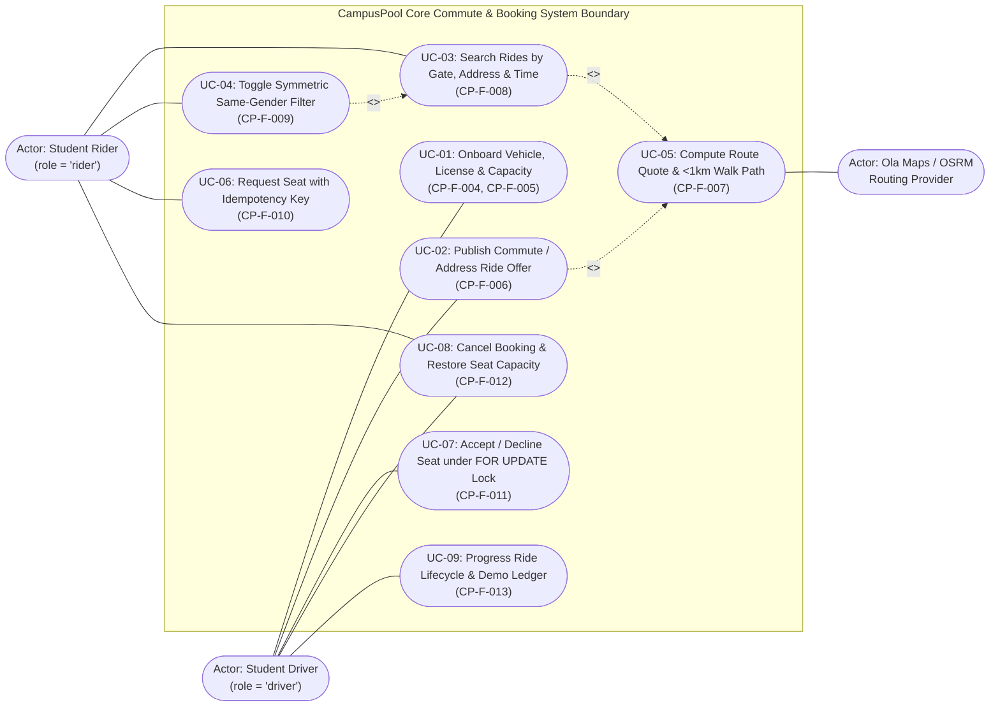
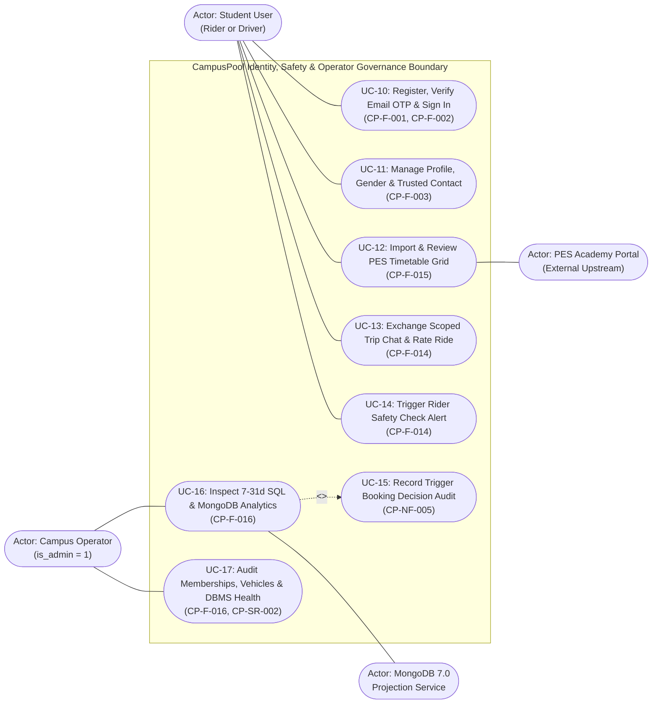

# Software Requirements Specification (SRS)

- **Project:** CampusPool — Collegiate Carpooling & Multi-Model Mobility Platform
- **Version:** 2.0 (Final Sprint-Reconciled Release)
- **Authors:**
  - Arjun Srikanth (`PES1UG24AM920` — `@arjunsrikanthh`)
  - Zayaan Ahmed (`PES1UG24AM457` — `@zayaan-06`)
  - Nikhil Suhas Joshi (`PES1UG24AM441` — `@NikhilJoshi441`)
  - NITHESH (`PES1UG24AM443` — `@NitheshMogaveer777`)
- **Date:** 16-11-2026
- **Status:** Final / Frozen for Evaluation
- **Repository:** [https://github.com/CampusPool/carpooling](https://github.com/CampusPool/carpooling)

---

## Revision History

| Version | Date | Author | Change Summary | Approval |
| :--- | :--- | :--- | :--- | :--- |
| 1.0 | 12-10-2026 | CampusPool Team | Initial IEEE SRS baseline with FRs, NFRs, Use-Case models, and Sprint-1/2 backlog mapping | Team Reviewed |
| 1.5 | 28-10-2026 | Nikhil Suhas Joshi & NITHESH | Added DBMS Level-3 relational/NoSQL requirements, preaggregated views, triggers, and concurrency locks | Team Reviewed |
| 2.0 | 16-11-2026 | Zayaan Ahmed & Arjun Srikanth | Reconciled Sprint-2/3 additions: Ola Maps routing, PES email OTP & password auth, gender-matched rides, driver setup, safety check, ratings, and PES Academy timetable review | Final Frozen |

---

## Approvals

| Role | Name | SRN / GitHub Handle | Signature / Email | Date |
| :--- | :--- | :--- | :--- | :--- |
| Backend & Runtime Lead | Arjun Srikanth | `PES1UG24AM920` (`@arjunsrikanthh`) | `arjunsrikanth17@gmail.com` | 16-11-2026 |
| Frontend & UX Lead | Zayaan Ahmed | `PES1UG24AM457` (`@zayaan-06`) | `zayaanahmed6506@gmail.com` | 16-11-2026 |
| QA, Routing & Discovery Lead | Nikhil Suhas Joshi | `PES1UG24AM441` (`@NikhilJoshi441`) | `nikhiljoshi441@pesu.pes.edu` | 16-11-2026 |
| Database & Integrity Lead | NITHESH | `PES1UG24AM443` (`@NitheshMogaveer777`) | `nitheshm777@pesu.pes.edu` | 16-11-2026 |
| Course Coordinator / Evaluator | Department of CSE | PES University | _Pending Final Demo Sign-Off_ | 16-11-2026 |

---

## Table of Contents

1. [Introduction](#1-introduction)
2. [Overall Description](#2-overall-description)
3. [External Interface Requirements](#3-external-interface-requirements)
4. [System Features (Detailed Functional Requirements)](#4-system-features-detailed-functional-requirements)
5. [Non-Functional Requirements (Detailed)](#5-non-functional-requirements-detailed)
   - [5.1 Security (Objectives & Requirements)](#51-security)
6. [Quality Attributes & Acceptance Tests](#6-quality-attributes--acceptance-tests)
7. [System Models and Diagrams (UML Use-Case Diagrams)](#7-system-models-and-diagrams)
8. [Requirements Traceability Matrix (RTM)](#8-requirements-traceability-matrix-rtm)

---

## 1. Introduction

### 1.1 Purpose
This Software Requirements Specification (SRS) defines the complete functional requirements (FRs), non-functional requirements (NFRs), security objectives, security requirements, external interface contracts, and verification criteria for **CampusPool v2.0**—an authenticated, university-scoped carpooling and commute coordination platform built for PES University students and operators. It follows the IEEE 830 / ISO/IEC/IEEE 29148 standard and reflects the frozen codebase across Sprint 1, Sprint 2, and Sprint 3.

### 1.2 Scope
**CampusPool** addresses suburban university commute congestion by connecting verified student drivers and riders travelling along shared corridors to and from campus gates. The platform encompasses:
- **Student Identity & Authentication:** Local username/password accounts and institutional PES email OTP/password verification (`StudentSignIn`, `LocalAccountSignIn`), with normalized role (`rider`/`driver`) and gender preferences (`male`/`female`/`other`).
- **Streamlined Vehicle & Driver Onboarding:** A 4-field driver onboarding workflow (`DriverOnboarding.tsx`) and a 10-entry demo vehicle catalogue (`DemoVehicle.php`) with capacity validation and immediate host readiness.
- **Geospatial Route Planning & Same-Gender Discovery:** Multi-modal route calculation using Ola Maps (`OlaDirectionsClient.php`, `OlaRouteProvider.php`) and containerized OSRM (`OsrmRouteProvider.php`), campus pickup-zone selection, sub-1-km walking threshold enforcement, and symmetric same-gender ride matching (`LiveCarpool.tsx`, `CommuteService.php`).
- **Transactional Seat Booking & Ride Lifecycle:** ACID seat reservations in MySQL 8.0 (InnoDB) guarded by `SELECT ... FOR UPDATE` row-level locks, idempotency keys, state-change triggers (`mobility_booking_decision_insert`/`update`), cancellations with automatic seat restoration, trip chat, ride ratings, and rider safety checks.
- **PES Academy Timetable Review & Recurrence:** Transient, user-reviewed timetable import (`POST /api/pes-timetable`) and weekly bitmask recurring schedule generation.
- **Dual-Engine Operator Control Center:** Protected `/admin` console and `/api/mobility/operator/analytics` endpoint combining MySQL 8.0 preaggregated views (`mobility_operator_ride_facts`), stored functions (`mobility_utilization_pct`), and recursive-CTE/window stored procedures (`mobility_operator_daily`) with an asynchronous MongoDB 7.0 event-projection read model (`mobility_activity_events`).

*Scope Exclusions:* Live banking/UPI real-money settlement (simulated wallet/cost-split tokens are used and explicitly labelled as demo records), physical cellular SMS gateways, and continuous background hardware GPS telemetry on physical phones are outside the classroom preview boundary.

### 1.3 Audience
Software Engineering and DBMS course instructors, project evaluators, undergraduate developers on the CampusPool team, QA engineers, and security reviewers.

### 1.4 Definitions, Acronyms, and Abbreviations
- **ACID:** Atomicity, Consistency, Isolation, Durability (enforced in MySQL 8.0 InnoDB).
- **CQRS:** Command Query Responsibility Segregation (MySQL 8.0 as write authority; MongoDB 7.0 as asynchronous analytical read model).
- **CTE:** Common Table Expression (`WITH RECURSIVE` calendar spine in `mobility_operator_daily`).
- **FR / NFR / SR:** Functional Requirement / Non-Functional Requirement / Security Requirement.
- **JWT:** JSON Web Token used for bearer session authentication.
- **OSRM:** Open Source Routing Machine (`car`, `bike`, and `foot` routing profiles).
- **OTP:** One-Time Password for institutional student email verification and password recovery.
- **RBAC:** Role-Based Access Control (`rider`, `driver`, and `operator`/`is_admin`).
- **RTM:** Requirements Traceability Matrix.
- **SRN:** Student Registration Number (e.g., `PES1UG24AM457`).

---

## 2. Overall Description

### 2.1 Product Perspective
CampusPool is a multi-tier, containerized web application comprising a **Next.js 14 / React 19** frontend (`frontend-next/`), an **Nginx + Laravel 11 (PHP 8.2)** backend (`backend/extensions/carpoolear/`), an authoritative **MySQL 8.0 (InnoDB)** relational database, an isolated **Node.js + MongoDB 7.0** activity projection microservice (`services/activity-projection/`), and pluggable geospatial routing providers (**Ola Maps API** and **OSRM**).

### 2.2 Major Product Functions (Detailed)
1. **Institutional & Local Account Lifecycle:** Register and sign in as a student rider or driver, verify institutional email via OTP, set up password recovery, and maintain profile attributes including gender and trusted safety contacts.
2. **Driver & Vehicle Setup:** Register vehicle plate (`patente`), category (`car` or `bike`), offered passenger seats, and driving license (`nro_doc`), or select from the validated 10-entry student demo vehicle catalogue.
3. **Ride Offer Publication:** Publish dated or address-based commute offers specifying origin, campus gate destination, departure timestamp, seat count, cost-share in minor units (paise), and optional `same_gender_only` restriction.
4. **Geospatial Discovery & Sub-1-km Pickup Matching:** Search compatible rides by place/gate and departure window, compute driving polylines and walking access paths (`< 1000m` combined walk), and filter by symmetric same-gender rules.
5. **Atomic Seat Request, Acceptance & Cancellation:** Submit idempotent seat requests, lock parent ride rows via `SELECT ... FOR UPDATE` during driver acceptance to prevent overbooking under concurrent load, and restore available seats upon cancellation.
6. **In-Trip Communication, Ratings & Safety Check:** Exchange participant-scoped trip messages, block abusive users, submit 1–5 star post-ride ratings, and trigger a rider safety check that dispatches trip context to a configured trusted contact.
7. **Timetable Preview & Recurring Commutes:** Preview imported PES Academy class slots before saving to MySQL, or define weekly bitmask recurring schedules.
8. **Executive Operator Analytics & DBMS Lab:** Inspect 7/14/31-day ride summaries, 7-day rolling averages (via SQL recursive CTE and window functions), microsecond booking decision audit logs (via SQL triggers), and daily lifecycle event counts (via MongoDB `$group`/`$sum` aggregation pipelines).

### 2.3 User Roles and Characteristics (Expanded)
- **Student Rider (`role = 'rider'`):** Commutes to/from PES University; searches routes, toggles same-gender matching, requests seats, chats with drivers, triggers safety checks, and rates completed rides.
- **Student Driver (`role = 'driver'`):** Commutes with a personal car or two-wheeler; completes vehicle/license onboarding, publishes ride offers, accepts/declines rider requests, and progresses trip states (`planned` → `active` → `completed`/`cancelled`).
- **Campus Operator / Administrator (`is_admin = 1`, `active = 1`, `banned = 0`):** Accesses `/admin` and `/api/mobility/operator/*` to audit cohort memberships, review driver onboarding, monitor SQL/MongoDB health, and analyze rolling 7–31 day capacity utilization.

### 2.4 Operating Environment
- **Client Environment:** Modern desktop and mobile web browsers (Chrome, Safari, Firefox, Edge) over HTTPS or localhost loopback (`http://localhost:3000`).
- **Server Runtime:** Docker Compose orchestration running Linux containers for Nginx (`:18080`), PHP-FPM 8.2 (Laravel 11), MySQL 8.0.36 (`InnoDB`), MongoDB 7.0, Node.js 20+ (`activity-projection`), and OSRM (`car`/`bike`/`foot` routers).

### 2.5 Design and Implementation Constraints
- **Transactional Authority Constraint:** MySQL 8.0 is the sole authority for identity, seat inventory, and financial postings. MongoDB 7.0 is strictly a non-blocking read model; a MongoDB outage must never fail a ride booking.
- **Engine-Level Data Integrity:** Database tables must enforce 3NF normalization, foreign keys (`ON DELETE CASCADE`/`SET NULL`), `UNIQUE` constraints, `CHECK` constraints (`seats_total > 0`, `origin <> destination`, `fare_minor >= 0`), and `validationLevel: "strict"` in MongoDB.
- **API Key & Credential Isolation:** Ola Maps server keys, `X-Mobility-Analytics-Key` secrets, and operator password hashes must reside exclusively in server environment variables and never leak into client bundles or Git history.
- **Upstream Licensing:** Reconstructed Carpoolear host integration preserves GPLv3 attribution while isolating all new CampusPool extensions under `backend/extensions/carpoolear/`.

---

## 3. External Interface Requirements

### 3.1 User Interfaces
- **Student Landing & Auth Portal (`LocalAccountLanding.tsx`, `StudentSignIn.tsx`):** Clean tabbed interface for Student Email OTP/Password Sign-In, Local Rider/Driver Registration (with gender selector), and Operator Sign-In.
- **Commute & Address Rides Workspace (`LiveCarpool.tsx`, `AddressRides.tsx`, `CanonicalPool.tsx`):** Interactive place autocomplete (`OlaPlaceInput.tsx`, `CanonicalPlacePicker.tsx`), static/interactive route preview (`OlaStaticRouteMap.tsx`, `OlaMapPanel.tsx`), "Same gender rides only" toggle button, and real-time seat availability badges.
- **Driver Setup Modal (`DriverOnboarding.tsx`):** Streamlined 4-field form (Vehicle Registration Number, Car/Bike Type, Pooling Capacity, Driving License) plus 10-entry demo vehicle selector.
- **Student Dashboard Extras (`PesTimetable.tsx`, `RideConversation.tsx`, `RideSafety.tsx`, `RideRating.tsx`):** Weekly timetable review grid, scoped trip chat panel, one-click trusted-contact safety check, and post-ride rating modal.
- **Admin Control Center (`AdminConsole.tsx`, `OperatorAnalytics.tsx`):** Dedicated `/admin` dashboard displaying MySQL summary cards, 7-day rolling averages, trigger audit logs, DBMS schema health, and MongoDB synchronization telemetry.

### 3.2 Hardware Interfaces
- **Client Devices:** Standard laptop, desktop, or smartphone display (360px to 1920px+ viewports) with keyboard/touch input. No proprietary hardware terminals are required; physical GPS sensors are simulated via deterministic coordinate waypoints in the classroom environment.

### 3.3 Software Interfaces
- **MySQL 8.0 Database Interface:** Connected via PHP PDO (`mysql` driver) executing prepared statements, transactions, row locks, views, stored functions, stored procedures, and triggers.
- **MongoDB 7.0 & Activity Projection Service:** Connected over the private container network (`http://activity-projection:4100/daily` and `/health`) using `X-Mobility-Analytics-Key`.
- **Geospatial Routing Interfaces:**
  - **Ola Maps REST API:** Autocomplete, Place Details, Directions (`car`, `bike`, `foot`), and Static Map proxy via server-side `OlaDirectionsClient.php` and `frontend-next/lib/ola-server.ts`.
  - **OSRM Routing Engine:** Containerized HTTP endpoints for `foot`, `bike`, and `driving` route polylines and duration matrices.
- **PES Academy Timetable Endpoint (`POST /api/pes-timetable`):** Server-side HTML/JSON parser (`frontend-next/lib/pesu-client.mjs`) that fetches class slots transiently without persisting raw portal credentials.

### 3.4 Communications Interfaces
- **Protocol:** HTTP/1.1 and HTTPS over TLS 1.2+ with JSON request/response payloads (`Content-Type: application/json`).
- **Authentication & Idempotency Headers:** `Authorization: Bearer <token>`, `Idempotency-Key: <uuid>`, and `X-Mobility-Analytics-Key: <32+ char secret>`.
- **Cache Control:** Sensitive operator and account endpoints emit `Cache-Control: private, no-store, max-age=0`.

---

## 4. System Features (Detailed Functional Requirements)

> **Compliance Note:** This section defines **16 detailed Functional Requirements (`CP-F-001` through `CP-F-016`)**, exceeding the minimum requirement of 15 FRs. Every FR is mapped to acceptance criteria and verified test cases.

### 4.1 Identity, Authentication & Profile Management (`CP-F-001` – `CP-F-003`)

| Req ID | Requirement (shall...) | Type | Priority | Source / Stakeholder | Acceptance Criteria / Test Case Ref | Comments / Dependencies |
| :--- | :--- | :--- | :--- | :--- | :--- | :--- |
| **CP-F-001** | The system shall allow eligible students to register and authenticate via institutional email OTP verification, password login, or local username/password accounts with explicit role (`rider` or `driver`) and normalized gender (`male`, `female`, `other`). | Functional | High | Student Users / Security | **AC-CP-F-001:** Valid registration creates `users` and `mobility_local_accounts` / `mobility_student_profiles` rows and returns a valid session token; duplicate usernames or invalid domains are rejected with HTTP 422. **Test:** `TC-AUTH-01`, `TC-AUTH-02` | `LocalAccountController.php`, `CollegeEmailAuthController.php` |
| **CP-F-002** | The system shall support account password recovery via one-time password (OTP) invalidation and allow authenticated sessions to be reused or cleanly revoked on sign-out. | Functional | High | Student Users / Security | **AC-CP-F-002:** Issuing a new OTP invalidates prior unused OTPs; signing out revokes the active token so subsequent API calls return HTTP 401. **Test:** `TC-AUTH-03` | `2026_11_10_000100_add_college_otp_invalidation.php` |
| **CP-F-003** | The system shall allow students to view and update their profile attributes, including display name, contact phone, gender preference, and trusted safety contact email. | Functional | Medium | Student Users | **AC-CP-F-003:** Profile updates persist in MySQL and immediately reflect in `GET /api/mobility/commute/me` and student profile views. **Test:** `TC-PROF-01` | `StudentProfile.tsx`, `StudentProfile.php` |

### 4.2 Driver & Vehicle Onboarding (`CP-F-004` – `CP-F-005`)

| Req ID | Requirement (shall...) | Type | Priority | Source / Stakeholder | Acceptance Criteria / Test Case Ref | Comments / Dependencies |
| :--- | :--- | :--- | :--- | :--- | :--- | :--- |
| **CP-F-004** | The system shall allow a student driver to onboard a vehicle by submitting vehicle registration number, vehicle category (`car` or `bike`), offered passenger seat capacity, and driving license number (`nro_doc`), or by selecting from the 10-entry validated demo vehicle catalogue. | Functional | High | Student Drivers | **AC-CP-F-004:** Valid submission creates/updates the `cars` record, stores `nro_doc`, and sets `host_approved = 1` in `mobility_memberships`. **Test:** `TC-DRV-01` | `DriverOnboarding.tsx`, `DemoVehicle.php` (#12) |
| **CP-F-005** | The system shall enforce legal vehicle passenger capacity limits (`1` seat for `bike`, `1–4` seats for `car`, `seats_total > 0`) at both the API validation layer and MySQL `CHECK` constraint layer. | Functional | High | Safety / Operations | **AC-CP-F-005:** Attempting to onboard or publish a bike ride with >1 passenger seat or a ride with 0 seats is rejected with HTTP 422 / SQL error `3819`. **Test:** `TC-DRV-02` | `DriverReservationPolicy.php`, `ck_dbms_rides_seats` |

### 4.3 Ride Publication, Geospatial Routing & Same-Gender Discovery (`CP-F-006` – `CP-F-009`)

| Req ID | Requirement (shall...) | Type | Priority | Source / Stakeholder | Acceptance Criteria / Test Case Ref | Comments / Dependencies |
| :--- | :--- | :--- | :--- | :--- | :--- | :--- |
| **CP-F-006** | The system shall allow an approved driver to publish a commute ride offer specifying origin, destination (distinct from origin), departure timestamp, vehicle type, available seats, shared-cost fare in minor units, and optional `same_gender_only` restriction. | Functional | High | Student Drivers | **AC-CP-F-006:** Valid publication inserts linked records into `trips`, `mobility_commute_demo_trips`, and `mobility_trip_lifecycles` (`state = 'planned'`). **Test:** `TC-PUB-01` | `CommuteController.php`, `AddressRideController.php` (#21) |
| **CP-F-007** | The system shall compute route polylines, distance, duration, and meeting-point walking paths using the configured geospatial routing provider (Ola Maps API or OSRM) and persist immutable route quotes (`mobility_route_quotes`). | Functional | High | Riders & Drivers | **AC-CP-F-007:** Route quotes return valid geometry and ETA; candidate meeting points enforce a combined rider walking distance strictly below `1,000 m`. **Test:** `TC-ROUTE-01` | `OlaDirectionsClient.php`, `OsrmRouteProvider.php` (#17, #101) |
| **CP-F-008** | The system shall allow riders to search for compatible open rides filtered by origin/campus pickup zone, direction (`to_campus`/`from_campus`), and departure time window, returning accurate remaining seat counts. | Functional | High | Student Riders | **AC-CP-F-008:** Search returns only `planned`/`active` rides within the time tolerance with `available_seats > 0`; empty searches render an explicit empty state. **Test:** `TC-DISC-01` | `CommuteMatchingService.php`, `PickupController.php` (#22, #26) |
| **CP-F-009** | The system shall enforce symmetric same-gender ride matching whenever either the driver's offer has `same_gender_only = true` or the searching rider enables the "Same gender rides only" filter. | Functional | High | Student Safety | **AC-CP-F-009:** When enabled by either party, discovery and booking only match riders and drivers sharing the exact same normalized gender (`male`↔`male`, `female`↔`female`, `other`↔`other`). **Test:** `TC-GEND-01` | `LiveCarpool.tsx`, `CommuteService.php` (PR #87) |

### 4.4 Transactional Seat Booking, Concurrency & Cancellations (`CP-F-010` – `CP-F-012`)

| Req ID | Requirement (shall...) | Type | Priority | Source / Stakeholder | Acceptance Criteria / Test Case Ref | Comments / Dependencies |
| :--- | :--- | :--- | :--- | :--- | :--- | :--- |
| **CP-F-010** | The system shall allow a rider to request a seat on an eligible ride and prevent a driver from booking a seat on their own ride at both service and database trigger levels. | Functional | High | Riders & Integrity | **AC-CP-F-010:** Valid request creates a pending booking (`request_state = 0`); self-booking is rejected with HTTP 422 / SQLSTATE `45000` (`driver cannot book own ride`). **Test:** `TC-BOOK-01` | `SegmentBookingService.php`, `dbms_bookings_before_insert` (#23) |
| **CP-F-011** | The system shall allow the driver to accept or decline pending seat requests inside an ACID transaction using `SELECT ... FOR UPDATE` row-level locking so concurrent acceptances never exceed `seats_total`. | Functional | High | Core DBMS Integrity | **AC-CP-F-011:** Under 12 concurrent competing requests for the final seat, exactly 1 commits as `accepted` (`request_state = 1`) and 11 fail cleanly with capacity rejection. **Test:** `TC-CAP-01` | `CommuteService.php`, `dbms_book_ride` (#23, #37) |
| **CP-F-012** | The system shall allow authorized riders or drivers to cancel a pending or accepted booking, transitioning `request_state` to `3 (Cancelled)` and atomically restoring the released seat to the ride's available inventory. | Functional | High | Riders & Drivers | **AC-CP-F-012:** Upon cancellation, `available_seats` increments by 1 and an audit event is recorded; unauthorized third-party cancellation returns HTTP 403. **Test:** `TC-CANC-01` | `MobilityCommuteProductTest.php` (#24) |

### 4.5 Trip Lifecycle, Communication, Safety & Ratings (`CP-F-013` – `CP-F-014`)

| Req ID | Requirement (shall...) | Type | Priority | Source / Stakeholder | Acceptance Criteria / Test Case Ref | Comments / Dependencies |
| :--- | :--- | :--- | :--- | :--- | :--- | :--- |
| **CP-F-013** | The system shall allow drivers to progress rides through `planned` → `active`/`in_progress` → `completed` or `cancelled`, and maintain double-entry synthetic cost-share postings (`debit`/`credit`) clearly labelled as classroom demo credits. | Functional | High | Riders & Drivers | **AC-CP-F-013:** Invalid state jumps are rejected; completed trips generate balanced `debit` and `credit` ledger entries (`amount > 0`). **Test:** `TC-LIFE-01` | `TripLifecycleService.php`, `mobility_financial_postings` (#25, #81) |
| **CP-F-014** | The system shall provide participant-scoped trip chat, localized departure reminders (`Asia/Kolkata`), post-ride 1–5 star ratings, and an in-ride safety check that notifies a student's trusted contact. | Functional | Medium | Student Safety & UX | **AC-CP-F-014:** Non-participants receive HTTP 403 on chat; completed rides accept 1–5 ratings; safety check logs and dispatches alert payload to trusted contact. **Test:** `TC-SAFE-01`, `TC-COMM-01` | `RideConversation.tsx`, `RideSafety.tsx`, `RideRating.tsx` (#13, #15, #31, #33) |

### 4.6 Timetable Integration & Multi-Model Operator Analytics (`CP-F-015` – `CP-F-016`)

| Req ID | Requirement (shall...) | Type | Priority | Source / Stakeholder | Acceptance Criteria / Test Case Ref | Comments / Dependencies |
| :--- | :--- | :--- | :--- | :--- | :--- | :--- |
| **CP-F-015** | The system shall allow signed-in students to import their weekly class timetable from PES Academy (`POST /api/pes-timetable`) into a transient preview grid, resolve slot alternatives, and explicitly save or edit entries in MySQL. | Functional | Medium | Student Commuters | **AC-CP-F-015:** Imported slots do not overwrite saved classes until explicitly confirmed; Academy credentials are never logged or persisted. **Test:** `TC-TIME-01` | `PesTimetable.tsx`, `pesu-client.mjs` (#27) |
| **CP-F-016** | The system shall provide an authenticated Operator Analytics & DBMS Control Center (`/admin`, `GET /api/mobility/operator/analytics`) powered by MySQL views, functions, recursive-CTE/window stored procedures, state-change triggers, and MongoDB `$group`/`$sum` event projections. | Functional | High | Campus Operators / DBMS | **AC-CP-F-016:** Operator dashboard displays 7/14/31-day SQL summaries, 7-day rolling ride averages, latest 20 trigger audit rows, and MongoDB daily action counts; non-admins receive HTTP 403. **Test:** `TC-OPER-01`, `TC-PROJ-01` | `OperatorAnalyticsController.php`, `AdminConsole.tsx` (#36, #40, PR #85) |

---

## 5. Non-Functional Requirements (Detailed)

> **Compliance Note:** This section defines **8 measurable Non-Functional Requirements (`CP-NF-001` through `CP-NF-008`)**, **4 Security Objectives**, and **6 Security Requirements (`CP-SR-001` through `CP-SR-006`)**, exceeding all template minimums (at least 5 NFRs, 2 security objectives, and 5 security requirements).

| Req ID | Requirement | Category | Priority | Acceptance Criteria / Measurement |
| :--- | :--- | :--- | :--- | :--- |
| **CP-NF-001** | **Response Time & Query Latency:** Core authentication (`POST /api/login`) and commute discovery (`GET /api/mobility/commute/search`) shall complete in $\le 2,000\text{ ms}$ for 90% of requests (`p90`) under a 200-offer campus workload, with indexed SQL lookup plans under `10 ms`. | Performance | High | Measured via `scripts/benchmark-http.py` and `EXPLAIN ANALYZE`: login `p90 = 22.0 ms`, search `p90 = 46.1 ms`, indexed SQL join `= 1.12 ms`. **Test:** `TC-PERF-01` |
| **CP-NF-002** | **Concurrency & ACID Isolation:** Concurrent seat requests and driver acceptances on the final remaining seat shall be serialized via InnoDB `SELECT ... FOR UPDATE` row locks with zero overbooked rides (`accepted_seats <= total_seats`). | Reliability / Data Integrity | High | 100% invariant preservation across 12 simultaneous competing requests in `commute-race` and `verify-dbms-level3.sh`. **Test:** `TC-CAP-01` |
| **CP-NF-003** | **Fault Isolation & Graceful Degradation:** An outage, timeout, or schema lag in the MongoDB activity projection service or external routing provider shall never corrupt MySQL bookings or crash the Operator Dashboard. | Availability / Resilience | High | Mongo calls bounded to `1s` connect / `2s` read timeout; when Mongo is stopped, SQL analytics still return HTTP 200 with `activity.status = "unavailable"`. **Test:** `TC-PROJ-02` |
| **CP-NF-004** | **Idempotency & Replay Safety:** Duplicate client mutations carrying the same `Idempotency-Key` and repeated SQL-to-MongoDB event replays (`sourceEventId`) shall execute at most once without creating duplicate rows. | Reliability / Consistency | High | Unique index `sourceEventId_1` in MongoDB and composite unique keys in MySQL reject duplicate inserts (`Code 11000` / `1062`); replay produces identical counts. **Test:** `TC-PROJ-01` |
| **CP-NF-005** | **Auditability & Temporal Precision:** Every booking request state change (`0: Pending`, `1: Accepted`, `2: Declined`, `3: Cancelled`) shall be automatically captured by database triggers with microsecond UTC precision (`DATETIME(6)`). | Auditability | High | `mobility_booking_decision_insert` and `mobility_booking_decision_update` populate `mobility_booking_decision_events` in the same transaction. **Test:** `TC-OPER-01` |
| **CP-NF-006** | **Engine-Level Schema Validation:** Both MySQL 8.0 and MongoDB 7.0 shall enforce strict structural and domain constraints (`CHECK`, `FOREIGN KEY`, `UNIQUE`, and `$jsonSchema` with `validationLevel: "strict"`). | Data Quality | High | Invalid negative fares, zero-seat rides, self-bookings, and malformed BSON documents (`Code 121`) are rejected by the database engine. **Test:** `TC-DBMS-01` |
| **CP-NF-007** | **Responsive Usability & Accessibility:** All primary student and operator screens shall support mobile (`360px`) and desktop (`1440px+`) layouts with explicit `aria-label` attributes, keyboard focus navigation, and clear loading/empty/error states. | Usability / Accessibility | Medium | Verified across 28 Vitest UI interaction suites using `@testing-library/react` role and label queries (`getByRole`, `getByLabelText`). **Test:** `TC-UI-01` |
| **CP-NF-008** | **Reproducibility & CI Automation:** The complete frontend, projection service, and backend patch-stack reconstruction shall execute deterministically in GitHub Actions CI and disposable Docker verification scripts. | Maintainability / Portability | High | `.github/workflows/mobility-platform.yml` and `.github/workflows/dbms-level3.yml` pass automatically on PRs and pushes. **Test:** `TC-CI-01` |

---

### 5.1 Security

#### 5.1.1 Security Objectives
1. **Objective SO-01 (Strict Authentication & Role/Cohort Authorization):** Ensure that every protected API endpoint authenticates the caller's bearer token and enforces strict RBAC (`rider`, `driver`, `operator`) and participant ownership boundaries in the backend and database—never relying on hidden UI buttons for security.
2. **Objective SO-02 (Credential, Secret & PII Confidentiality):** Prevent API keys (`OLA_MAPS_API_KEY`, `X-Mobility-Analytics-Key`), passwords, session tokens, and raw PES Academy credentials from ever appearing in browser bundles, Git history, error responses, or MongoDB analytical projections.
3. **Objective SO-03 (Abuse, Brute-Force & SSRF/Injection Resistance):** Protect authentication and external proxy endpoints against brute-force login attacks, SQL/NoSQL injection, cross-origin credential forwarding, and unbounded payload memory exhaustion.
4. **Objective SO-04 (Non-Repudiation & Tamper-Evident Auditing):** Maintain an immutable, database-trigger-enforced audit trail of booking state transitions and version-checked operator review decisions.

#### 5.1.2 Security Requirements

| Req ID | Requirement (shall...) | Type | Priority | Acceptance Criteria / Test Case Ref |
| :--- | :--- | :--- | :--- | :--- |
| **CP-SR-001** | The system shall hash all user and operator passwords using `bcrypt` (`PASSWORD_BCRYPT`) and never store, log, or return plaintext passwords or raw OTP codes in API responses. | Security | High | **AC-CP-SR-001:** Inspecting `users`, `student_password_accounts`, and logs confirms only `bcrypt` hashes exist; login responses omit password fields. **Test:** `TC-SEC-01` |
| **CP-SR-002** | The system shall enforce Role-Based Access Control (RBAC) and participant ownership on all ride, chat, safety, and `/api/mobility/operator/*` endpoints, returning `HTTP 401` for unauthenticated requests and `HTTP 403` for unauthorized roles or non-participants. | Security | High | **AC-CP-SR-002:** Anonymous or student-role requests to `/api/mobility/operator/analytics` or another user's trip chat are rejected with HTTP 401/403. **Test:** `TC-SEC-02` |
| **CP-SR-003** | The system shall protect administrator and OTP sign-in endpoints with brute-force rate limiting (`AdminLoginThrottle` and per-session attempt caps), returning `HTTP 429 (LOGIN_RATE_LIMITED)` upon threshold violation. | Security | High | **AC-CP-SR-003:** Exceeding consecutive failed login attempts triggers `HTTP 429` and blocks further attempts during the cooldown window. **Test:** `TC-SEC-03` |
| **CP-SR-004** | The system shall isolate the MongoDB activity projection service on the private container network without host-published ports, requiring a $\ge 32$-character `X-Mobility-Analytics-Key` header and stripping PII (names, chat, GPS coordinates, raw payloads) from projected BSON documents. | Security | High | **AC-CP-SR-004:** Requests to `/daily` without a valid 32+ char key fail with HTTP 401/403; projected MongoDB documents contain only allow-listed integer IDs, action enums, and timestamps. **Test:** `TC-SEC-04` |
| **CP-SR-005** | The system shall proxy Ola Maps and PES Academy requests server-side, enforcing same-origin checks, fixed upstream HTTPS origins (blocking cross-origin redirects before forwarding credentials), a `4,096`-byte request body cap, and a `2 MB` upstream stream cap. | Security | High | **AC-CP-SR-005:** Cross-origin redirects or oversized responses in `pesu-client.mjs` are aborted immediately without leaking credentials; Ola server API keys never appear in client network payloads. **Test:** `TC-SEC-05` |
| **CP-SR-006** | The system shall emit `Cache-Control: private, no-store, max-age=0` on all operator analytics and sensitive session responses, and invalidate client view state upon token change or sign-out so one account's data cannot persist on a shared screen. | Security | Medium | **AC-CP-SR-006:** Response headers include `Cache-Control: private, no-store, max-age=0`; switching tokens immediately clears stale operator state. **Test:** `TC-SEC-06` |

---

## 6. Quality Attributes & Acceptance Tests

- **Entry Criteria:** Containerized MySQL 8.0, MongoDB 7.0, Laravel 11, Activity Projection Service, and Next.js 14 builds are healthy; migrations and seed fixtures are applied on an isolated disposable database.
- **Exit Criteria for Acceptance:**
  1. 100% of high-priority Functional Requirements (`CP-F-001`..`CP-F-016`), Non-Functional Requirements (`CP-NF-001`..`CP-NF-008`), and Security Requirements (`CP-SR-001`..`CP-SR-006`) are implemented and mapped in the RTM.
  2. All 28 Frontend Vitest suites (`171` component/interaction tests + `10` PESU client unit tests + contract & map-loader checks), `4` Activity Projection microservice tests, `12` standalone segment-matcher assertions, and the `444` Backend PHPUnit integration tests pass with `0` critical defects open.
  3. Both DBMS verification suites (`sh scripts/verify-dbms-level3.sh` and `sh scripts/verify-dbms-application.sh`) pass all SQL DDL/DML/View/Function/Procedure/Trigger and MongoDB `$jsonSchema`/RUD/Aggregation assertions.

---

## 7. System Models and Diagrams

### 7.1 UML Use-Case Diagrams

In accordance with the SRS template requirement (at least 2 UML Use-Case Diagrams), we provide two complementary UML Use-Case diagrams modeling **(1) Core Student Commute, Geospatial Discovery & Transactional Booking Use Cases**, and **(2) Institutional Identity, Safety, Timetable & Dual-DB Operator Governance Use Cases**.

#### 7.1.1 Use-Case Diagram 1: Core Student Commute, Same-Gender Discovery & Transactional Seat Booking

#### 7.1.2 Use-Case Diagram 2: Identity, Student Safety, Timetable Import & Dual-Engine Operator Analytics

---

## 8. Requirements Traceability Matrix (RTM)

> **Status Legend:** `A` = Approved & Automated Test Passing | `P` = Passed in Verification Suite | `N` = Not Run

| Req ID | Requirement Short Description | Section Ref / Design Spec | Implementation Module | Test Case(s) | Status (N/P/A) | Comments / PR Ref |
| :--- | :--- | :--- | :--- | :--- | :---: | :--- |
| **CP-F-001** | Student OTP, password & local role/gender auth | Sec 4.1 / DS-Auth-01 | `LocalAccountController.php`, `CollegeEmailAuth.php` | `TC-AUTH-01`, `TC-AUTH-02` | **A** | PR #83, #100, #103 |
| **CP-F-002** | OTP invalidation & session token revocation | Sec 4.1 / DS-Auth-02 | `StudentPasswordAuth.php`, `StudentBrowserSession.php` | `TC-AUTH-03` | **A** | PR #100, #103 |
| **CP-F-003** | Student profile, gender & safety contact update | Sec 4.1 / DS-Prof-01 | `StudentProfile.php`, `StudentProfile.tsx` | `TC-PROF-01` | **A** | PR #103 |
| **CP-F-004** | 4-field driver onboarding & 10-car demo catalogue | Sec 4.2 / DS-Drv-01 | `DriverOnboarding.tsx`, `DemoVehicle.php` | `TC-DRV-01` | **A** | PR #87, #100 |
| **CP-F-005** | Vehicle seat capacity validation (`bike=1`, `car<=4`) | Sec 4.2 / DS-Drv-02 | `DriverReservationPolicy.php`, `evidence.sql` | `TC-DRV-02` | **A** | PR #70, #85 |
| **CP-F-006** | Publish dated & address-based commute ride offers | Sec 4.3 / DS-Pub-01 | `CommuteController.php`, `AddressRideController.php` | `TC-PUB-01` | **A** | PR #84, #87, #100 |
| **CP-F-007** | Ola Maps & OSRM routing with `<1km` walk check | Sec 4.3 / DS-Route-01 | `OlaDirectionsClient.php`, `OsrmRouteProvider.php` | `TC-ROUTE-01` | **A** | PR #93, #100, #102 |
| **CP-F-008** | Commute & campus pickup-zone ride discovery | Sec 4.3 / DS-Disc-01 | `CommuteMatchingService.php`, `PickupController.php` | `TC-DISC-01` | **A** | PR #86, #89 |
| **CP-F-009** | Symmetric same-gender ride matching filter | Sec 4.3 / DS-Gend-01 | `CommuteService.php`, `LiveCarpool.tsx` | `TC-GEND-01` | **A** | PR #87 (`feat/same-gender-matching`) |
| **CP-F-010** | Seat request & driver self-booking prevention | Sec 4.4 / DS-Book-01 | `SegmentBookingService.php`, `dbms_bookings_before_insert` | `TC-BOOK-01` | **A** | PR #84, #85 |
| **CP-F-011** | Row-locked (`FOR UPDATE`) atomic seat acceptance | Sec 4.4 / DS-Book-02 | `CommuteService.php`, `dbms_book_ride` | `TC-CAP-01` | **A** | PR #84, #86 |
| **CP-F-012** | Booking cancellation & automatic seat restoration | Sec 4.4 / DS-Canc-01 | `CommuteService.php`, `MobilityCommuteProductTest.php` | `TC-CANC-01` | **A** | PR #73, #84 |
| **CP-F-013** | Ride lifecycle progression & demo double-entry ledger | Sec 4.5 / DS-Life-01 | `TripLifecycleService.php`, `mobility_financial_postings` | `TC-LIFE-01` | **A** | PR #84, #85 |
| **CP-F-014** | Scoped trip chat, reminders, ratings & safety check | Sec 4.5 / DS-Safe-01 | `TripCommunicationController.php`, `StudentSafetyController.php` | `TC-SAFE-01`, `TC-COMM-01` | **A** | PR #89, #103 |
| **CP-F-015** | Transient PES Academy timetable import & review | Sec 4.6 / DS-Time-01 | `PesTimetableController.php`, `pesu-client.mjs` | `TC-TIME-01` | **A** | PR #96, #100 |
| **CP-F-016** | Dual-DB Operator Analytics & DBMS Control Center | Sec 4.6 / DS-Oper-01 | `OperatorAnalyticsController.php`, `AdminConsole.tsx` | `TC-OPER-01`, `TC-PROJ-01` | **A** | PR #85, #100 |
| **CP-NF-001** | Login & search latency `p90 <= 2000ms` (`22ms`/`46ms`) | Sec 5 / DS-Perf-01 | `scripts/benchmark-http.py`, composite SQL indexes | `TC-PERF-01` | **A** | PR #89 (#41) |
| **CP-NF-002** | Zero overbooking under 12x concurrent load | Sec 5 / DS-Conc-01 | `RouteSegmentMatcherStandalone.php`, InnoDB locks | `TC-CAP-01` | **A** | PR #83, #86 (#37) |
| **CP-NF-003** | MongoDB / provider outage fault isolation | Sec 5 / DS-Res-01 | `OperatorAnalyticsController::activity` (`2s` timeout) | `TC-PROJ-02` | **A** | PR #85 (#40) |
| **CP-NF-004** | Idempotent API mutations & MongoDB event replay | Sec 5 / DS-Idem-01 | `legacy-api.ts`, `sourceEventId_1` unique index | `TC-PROJ-01` | **A** | PR #85 |
| **CP-NF-005** | Microsecond `DATETIME(6)` trigger decision audit | Sec 5 / DS-Trig-01 | `mobility_booking_decision_insert`/`update` | `TC-OPER-01` | **A** | PR #85 |
| **CP-NF-006** | Engine-level SQL `CHECK`/`FK` & Mongo `$jsonSchema` | Sec 5 / DS-Schem-01 | `evidence.sql`, `mongo.js`, `verify-dbms-level3.sh` | `TC-DBMS-01` | **A** | PR #83, #85 |
| **CP-NF-007** | Responsive UI & accessible role/label semantics | Sec 5 / DS-UX-01 | `frontend-next/components/*` | `TC-UI-01` | **A** | PR #87, #100 (#42) |
| **CP-NF-008** | Automated GitHub Actions CI & disposable verifiers | Sec 5 / DS-CI-01 | `.github/workflows/mobility-platform.yml` | `TC-CI-01` | **A** | PR #88 (#39, #44) |
| **CP-SR-001** | Bcrypt password hashing & secret redaction | Sec 5.1.2 / DS-Sec-01 | `StudentPasswordAuth.php`, `OperatorPasswordController.php` | `TC-SEC-01` | **A** | PR #100, #103 |
| **CP-SR-002** | Multi-role RBAC & participant ownership guards | Sec 5.1.2 / DS-Sec-02 | `MobilityCohortSecurityTest.php`, `OperatorAnalyticsController` | `TC-SEC-02` | **A** | PR #85, #86 (#38) |
| **CP-SR-003** | Brute-force login & OTP rate limiting (`HTTP 429`) | Sec 5.1.2 / DS-Sec-03 | `AdminLoginThrottle`, `CollegeEmailOtpSecurityTest.php` | `TC-SEC-03` | **A** | PR #100 |
| **CP-SR-004** | Private Mongo network, 32+ char key & PII stripping | Sec 5.1.2 / DS-Sec-04 | `services/activity-projection/src/service.mjs` | `TC-SEC-04` | **A** | PR #85 |
| **CP-SR-005** | Server-side proxy bounds & redirect origin guards | Sec 5.1.2 / DS-Sec-05 | `pesu-client.mjs`, `ola-server.ts` | `TC-SEC-05` | **A** | PR #96, #100 |
| **CP-SR-006** | `Cache-Control: no-store` & stale-session cleanup | Sec 5.1.2 / DS-Sec-06 | `OperatorAnalyticsController.php`, `OperatorAnalytics.tsx` | `TC-SEC-06` | **A** | PR #85 |
